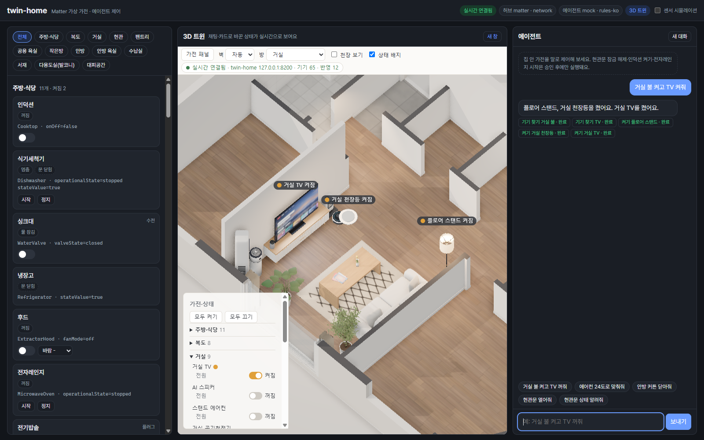

<div align="center">

<h1>twin-home</h1>

**The Matter-based control layer for the home digital twin: it turns twin-studio's materials into devices you can operate by chat**

Team 2026-SWE | 26-2 Software Engineering


</div>

---

### Description

twin-home loads the apartment built in [twin-studio](https://github.com/2026-SWE/twin-studio) and brings its appliances to life as 65 virtual Matter devices. Ask in Korean, and an agent finds the right devices, checks what needs your approval, and switches them, while the 3D twin shows every change live.



---

### 1. Key Features

#### 01. Virtual Matter Appliances

- Expose the twin's lights, TV, air conditioners, cooktop, door lock, curtains and more as 65 devices on one matter.js bridge.
- Devices are commissioned over the real Matter protocol, so a device's Matter attributes are the single source of its state.

#### 02. Chat Control Agent

- Control the home in plain Korean: "거실 불 켜고 TV 꺼줘", "에어컨 24도로 맞춰줘".
- The agent calls device tools (find, turn on/off, set level, climate, curtains, lock, start/stop) through OpenAI, Anthropic, or a rule-based mock that needs no API key.

#### 03. Approval Policy

- Risky commands, such as unlocking the front door, turning on the cooktop, or starting the microwave, wait for the user's approval.
- The LLM can never approve for itself. Approval tokens work once and expire after 5 minutes.

#### 04. Live 3D Twin Sync

- Every change from chat, device cards or MCP is pushed over WebSocket to the twin-studio viewer embedded in the page.
- Changes made in the 3D view travel back through the same approval policy.

#### 05. MCP Server

- The same device tools are available over MCP, so Claude Code or Claude Desktop can act as the home's agent.

---

### 2. Tools & Architecture

```text
Web UI (web/)            — Chat · device cards · embedded 3D viewer
        ↓  REST / WebSocket
Server (src/server)      — Node.js 22
├── Agent (src/agent)    — LLM tool loop: OpenAI · Anthropic · mock
├── Policy               — Approval for risky commands
└── Device hub
    ├── MatterHub        — matter.js bridge (65 devices) + controller
    └── MemoryHub        — No-Matter mode for fast tests

MCP server (src/mcp)     — Same tools over stdio, calls the server's REST API
twin-studio              — scene.json → device list · 3D viewer served at /twin/
```

Every command, wherever it comes from, passes the approval policy and changes a Matter attribute. The server then broadcasts that change to the web UI and the 3D twin.

---

### 3. GenAI Development Tool

- Claude Code (Claude Opus 5.5)

### 4. Platform

- Node.js server with a web UI
- Windows 11

---

<details>
<summary><b>Run it locally</b></summary>

Requires Node.js 22+ and [twin-studio](https://github.com/2026-SWE/twin-studio) cloned next to this repo (`../twin-studio`). The device list comes from twin-studio's data. The 3D view needs the twin built there first (`uv run python -m studio apartment`).

```bash
npm install
cp .env.example .env   # optional: OPENAI_API_KEY or ANTHROPIC_API_KEY
npm start              # http://127.0.0.1:8200
```

Without an API key, the rule-based mock agent runs. Try "거실 불 켜고 TV 꺼줘" or "현관문 열어줘" (asks for approval).

| Command | What it does |
|---|---|
| `npm test` | Unit, Matter integration and end-to-end tests (Vitest) |
| `npm run typecheck` | `tsc --noEmit` |
| `npm run demo` | Run 5 demo scenarios against a fresh server and print the results |
| `HUB=memory npm start` | Start without Matter (faster) |
| `claude mcp add twin-home -- npx tsx src/mcp/server.ts` | Register the MCP server in Claude Code (keep `npm start` running) |

</details>

<details>
<summary><b>Documentation</b></summary>

- [Contract](docs/plan.md): interfaces and formats. Change this first before changing them in code.
- [Full reference](docs/reference.md) (Korean): environment variables, REST and WebSocket API, 3D sync, Matter pairing, device mapping, tests, known limits

</details>
