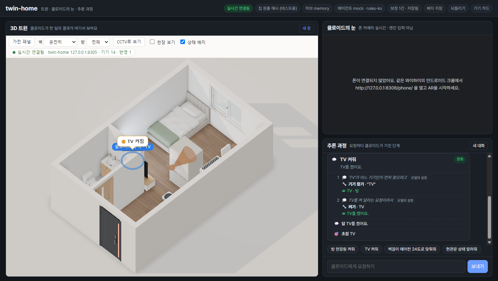

<div align="center">

<h1>twin-home</h1>

**The runtime that shows CLOiD's brain: it loads a home from twin-studio and lets you watch what CLOiD sees, what it knows about the home, how it decides, and what it does**

Team 2026-SWE | 26-2 Software Engineering


</div>

---

### Description

twin-home is where CLOiD's brain runs and becomes visible. [twin-studio](https://github.com/2026-SWE/twin-studio) builds and keeps the assets of each home; twin-home loads one home's assets and runs the loop a home robot needs:

| Stage | What twin-home does | Where you see it |
|---|---|---|
| **Sense** | A phone acts as CLOiD's eye: its AR pose and camera stream in, and each photo carries where it was taken | CLOiD's eye pane, eye marker in the 3D twin |
| **Model** | Keeps the home's state: its appliances as virtual Matter devices, mirrored in the 3D twin | 3D twin, device cards |
| **Decide** | An agent turns a request into tool calls and stops at risky ones for approval | Reasoning pane: thought, action and observation for each step |
| **Act** | Every command passes the approval policy and changes a Matter attribute | 3D twin updates, Matter state |

Today the Decide stage is an LLM tool agent. The judgment engine designed in the [docs](https://github.com/2026-SWE/docs) repo (knowing what it does not know, checking only what changes a decision) is meant to replace it here.



---

### 1. Key Features

#### 01. Three-Pane Dashboard

- The left pane is the 3D twin, where the results of what CLOiD did show up. The top right is CLOiD's eye, the live phone camera, marked as display only and not engine input. The bottom right is the reasoning log.
- The reasoning log has one card per request. Collapsed, it shows the request and the answer. Expanded, each step shows a thought, an action and an observation, followed by the answer and the focus target.
  - The thought is the model's own explanation of why it calls a tool. It is labeled as such and is not the evidence.
  - The action is the tool and its target. The observation is built from the tool result, not by the model.
- Approval buttons sit inside the card that asked for them. Phone talk, photos and layout saves appear in the same log.
- Device cards (Matter attributes, sensor simulation) are hidden by default and open as a drawer.

#### 02. Virtual Matter Appliances

- Expose the home's lights, TV, air conditioners, cooktop, door lock, curtains and more as devices on one matter.js bridge: 65 for the apartment, 14 for the one-room sample.
- Devices are commissioned over the real Matter protocol, so a device's Matter attributes are the single source of its state.

#### 03. Chat Control Agent

- Control the home in plain Korean: "TV 켜줘", "에어컨 24도로 맞춰줘".
- The agent calls device and layout tools through OpenAI, Anthropic, or a rule-based mock that needs no API key. Every tool call carries a short `reason`, which becomes the thought in the reasoning log.

#### 04. Approval Policy

- Risky commands, such as unlocking the front door, turning on the cooktop, or starting the microwave, wait for the user's approval.
- The LLM can never approve for itself. Approval tokens work once and expire after 5 minutes.

#### 05. Live 3D Twin Sync

- Every change from chat, device cards or MCP is pushed over WebSocket to the twin-studio viewer embedded in the page.
- Changes made in the 3D view travel back through the same approval policy.

#### 06. MCP Server

- The device tools are available over MCP, so Claude Code or Claude Desktop can act as the home's agent. Layout tools and the `reason` argument are only for the agent inside the server.

#### 07. CLOiD's Eye (phone AR)

- An Android phone opens a web page in Chrome and becomes CLOiD's eye. WebXR AR tracks its position and direction, and two room corners set in the floor plan (`ar_anchors`) align it to the twin. Homes without them use the dock and the front door.
- The phone is held in landscape: aim point in the middle, large talk, photo and stop buttons on one side, a thin status line on top, and the rest in a ⋯ menu.
- Camera frames are encoded to JPEG in web workers, two at a time, and sent at up to 12 frames per second by default, 480 px wide in landscape and 360 px in portrait (`?fps=`, `?w=`). The phone menu shows the frames sent, readPixels and encoding time, and why frames were skipped. The server reports the frames it receives at `/api/eye/stats`, and the eye pane shows that rate.
- "Take photo" saves a full-size photo with the twin position and direction it was taken from.
- The phone server listens on the Wi-Fi network but serves only the phone page and its WebSocket. Device control REST stays on 127.0.0.1; the phone reaches the agent only through its talk messages.

#### 08. Any Home, Corrected on Site

- Pick a home from twin-studio's `homes.json` with `HOME_ID` (the apartment, or the one-room sample). The viewer, device list and AR anchors follow that home.
- Fix the twin to match the real room by chat, or by aiming the phone at the floor and saying "냉장고 위치 여기로 맞춰줘" (move the fridge here). Furniture and appliances can be moved, turned, added and removed, and the 3D twin changes at once.
- "배치 저장해" (save the layout) writes `runtime/homes/<id>/edits.json`. twin-studio's `apply-edits` folds it into the home; after a rebuild and restart, added appliances become Matter devices.

#### 09. Voice and Focus

- Hold the talk button on the phone and speak Korean. Chrome's built-in speech recognition, which sends the audio through Google's servers, turns it into a chat message, and the reply is read aloud. Risky actions ask for approval on the phone or the dashboard.
- Whatever CLOiD just handled (the TV it turned on, the fridge it moved) gets a blue focus ring in the 3D twin and on the phone screen, and the phone draws the same ring into the live eye view.

---

### 2. Tools & Architecture

```text
Phone (web/phone/)       — CLOiD's eye: WebXR pose + aim point · camera frames (worker JPEG) · photos · voice
        ↓  WebSocket /phone/events (Wi-Fi)
Phone server (src/phone) — Align to the twin (room corners) · eye pose · "here" · voice relay · focus · MJPEG feed · stats
        ↓
Web UI (ui/, React)      — 3D twin · status pill · CLOiD's eye · decision log (no input)
        ↓  REST / WebSocket /events (127.0.0.1)
Server (src/server)      — Node.js 22
├── Agent (src/agent)    — Decide: LLM tool loop (OpenAI · Anthropic · mock), device + layout tools, thought and observation per step
├── Layout (src/layout)  — Runtime corrections on top of the home's scene.json · focus
├── Policy               — Approval for risky commands
└── Device hub           — Model + Act
    ├── MatterHub        — matter.js bridge + controller
    └── MemoryHub        — No-Matter mode for fast tests

MCP server (src/mcp)     — Device tools over stdio, calls the server's REST API
twin-studio              — Home packages (homes.json): scene.json → device list and anchors · viewer at /twin/viewer/ · library at /twin/lib/
```

Every command, wherever it comes from, passes the approval policy and changes a Matter attribute. The server then broadcasts that change to the web UI and the 3D twin. What the phone sees is shown, never fed to the decision step.

---

### 3. GenAI Development Tool

- Claude Code (Claude Opus 5.5)

### 4. Platform

- Node.js server with a web UI, and an Android Chrome page for the phone
- Windows 11

---

<details>
<summary><b>Run it locally</b></summary>

Requires Node.js 22.15. The twin runtime assets (viewer, homes, catalog) live in `twin/`, copied from [twin-studio](https://github.com/2026-SWE/twin-studio) builds. To refresh them, build the homes in twin-studio, then run `npx tsx scripts/twin-assets.ts --from <twin-studio folder>` to refill `twin/`.

```bash
npm install
npm --prefix ui install  # dashboard and setup pages (React)
cp .env.example .env   # optional: OPENAI_API_KEY or ANTHROPIC_API_KEY
npm start              # builds the pages, then http://127.0.0.1:8200
```

Without an API key, the rule-based mock agent runs. Try "TV 켜줘", "에어컨 24도로 맞춰줘" or "현관문 열어줘" (asks for approval).

| Command | What it does |
|---|---|
| `npm test` | Unit, Matter integration and end-to-end tests (Vitest) |
| `npm run typecheck` | `tsc --noEmit` |
| `npm run demo` | Run 5 demo scenarios against a fresh server and print the results |
| `HUB=memory npm start` | Start without Matter (faster) |
| `PHONE_PORT=8210 npm start` | Also serve the phone AR page that moves CLOiD's eye in the 3D twin ([setup](docs/reference.md#폰-ar-클로이드의-눈)) |
| `HOME_ID=oneroom PHONE_PORT=8210 npm start` | Load the one-room sample from twin-studio's `homes.json` with the phone page ([correcting it on site](docs/reference.md#집-고르기와-배치-보정)) |
| `claude mcp add twin-home -- npx tsx src/mcp/server.ts` | Register the MCP server in Claude Code (keep `npm start` running) |

</details>

<details>
<summary><b>Documentation</b></summary>

- [Contract](docs/plan.md): interfaces and formats. Change this first before changing them in code.
- [Full reference](docs/reference.md) (Korean): environment variables, REST and WebSocket API, 3D sync, phone AR, layout corrections, Matter pairing, device mapping, tests, known limits
- [Phone stream speed experiment](docs/experiments/2026-10-24-phone-stream-speed.md) (Korean): why the live eye view was slow, what was changed, and what to measure next

</details>
