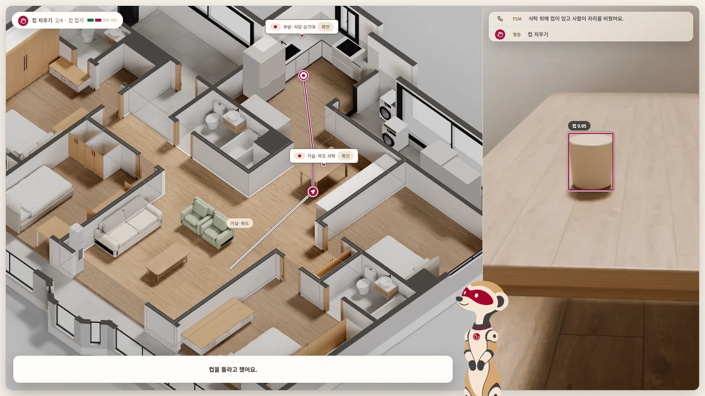
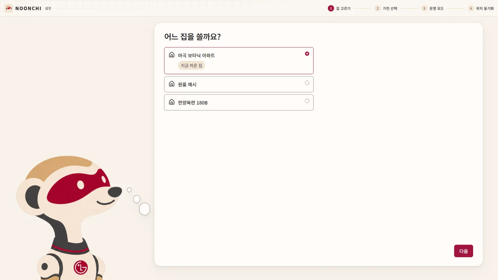

<div align="center">

<h1>NOONCHI (twin-home)</h1>

**홈 로봇 클로이드(CLOiD)가 집을 보고, 알고, 판단하고, 사람에게 할 일을 알려 주는 과정을 돌리고 보여 주는 서버**

noonchi-home | 26-2 소프트웨어공학


</div>

---

### 소개

[twin-studio](https://github.com/noonchi-home/twin-studio)가 집마다 3D 모델과 장면을 만들고, 이 저장소는 한 집을 불러와 클로이드의 머리를 돌린다.

| 단계 | 하는 일 | 보이는 곳 |
|---|---|---|
| **보기** | 실제 폰이 클로이드의 눈이다. 카메라 화면과 AR 위치가 들어오고, 사진마다 YOLO26n(물체·사람)과 VLM이 따로 분석한다. VLM은 최근 5장(2초 간격)을 함께 보고 집기·마시기·내려놓기 같은 행동도 읽는다. 사람이 보이면 YOLO26n-pose가 자세와 손에 든 컵을 본다. | 대시보드 폰 칸(YOLO 상자) |
| **알기** | World State가 YOLO·VLM 결과와 집 장면(가전·가구·도면 설비)을 합쳐 지금 상태와 관찰 글을 만든다. 볼 수 있는 것은 [낱말 표](docs/world-vocabulary.md)의 물건 30종·가전 설비 6종·사람 자세와 하는 일·가전 상태와 사건뿐이다. 가전은 Matter 가상 기기다. | 3D 트윈, FSM 카드 |
| **판단** | 폰 사진이 오는 동안 5초마다 PAM이 그때 관찰 글만 받아 할 일을 고른다(FSM이 계기·행동을 정한다). 사진은 넘기지 않는다. 폰 사진이 10초 넘게 안 오면 부르지 않아 비용도 없다. 지금 행동 목록은 컵 치우기·사용자에게 물어보기·세탁물 건조기로 옮기기·에어컨 켜기다. 말로 시킨 가전 명령은 에이전트(LLM 도구)가 맡는다. | 말풍선 카드 |
| **행동** | 에이전트(LLM 도구)가 고른 일을 계획으로 만든다: 경로, 사람에게 하는 단계 명령, 가전 조작, 행동 중 기다리기. 실제 폰으로 사람에게 하나씩 지시하고, World State와 폰 위치로 그 단계가 된 것을 본 뒤 다음 단계를 지시한다. 기다리기(예: 세탁 멈춤)는 폰에 보내지 않고 트윈 진행도에만 「기다리는 중」으로 보인다. 가전 명령은 승인 규칙을 거쳐 Matter 속성을 바꾼다. | 실제 폰, 트윈 진행도 |

예: 식탁에 컵이 남아 있고 사람이 자리를 비우면 PAM이 컵 치우기를 고른다. 실제 폰에 「식탁으로 가 주세요」 → 「컵을 들어 주세요」 → 「싱크대로 가 주세요」 → 「컵을 싱크대에 넣어 주세요」가 차례로 뜬다. 폰이 식탁 1.2 m 안에 들어오면 다음, 컵이 손에 있으면 다음, 싱크대 안이면 끝이다.



---

### 1. 주요 기능

#### 01. 대시보드

- 왼쪽은 3D 트윈, 오른쪽은 세로 폰 칸이다. 두 칸은 붙어 있고 둘 다 화면 높이를 다 쓴다. 대시보드에는 입력창이 없다.
- 3D 트윈: 한양목련 180B는 빛을 구운 three.js 트윈으로 그린다. 카메라는 각도가 고정된 정사영이고 계획 단계를 따라 확대·이동한다. 경로, 판단하며 확인한 기기의 말풍선을 그 위에 그린다. 폰 위치를 맞추면 클로이드의 눈을 보는 방향 원뿔로 그 자리·방향에 그린다. 원뿔은 벽 속에 서지 않고 문을 지나 옮겨 간다. 맞추기 전에는 보이지 않는다. 다른 집은 iframe 뷰어로 보인다.
- 진행도 칩: 할 일 이름과 지금 단계(예: 컵 치우기 2/4 · 컵 집기).
- 폰 칸: 실제 폰 영상과 물체 모양(마스크, 종류 무리마다 다른 색)·이름표. 네모 상자는 그리지 않는다. 위에 반투명 FSM 카드가 PAM 관찰 한 문장과 고른 행동을 보인다.
- 말풍선 카드: 클로이드가 정한 것이나 폰으로 내린 명령을 한 줄로 쓴다(예: 「컵을 들라고 했어요.」).
- 마스코트: 두 칸 사이 선 위에 선다. 지켜볼 때는 영상 쪽을, 행동하기로 하면 몸을 돌려 트윈 쪽을 본다. 누르면 설정 창이 열린다(연결, 운영 모드, 허브, 에이전트, 집, 폰 연결 QR, 「집 다시 설정하기」).
- 서버 연결이 끊긴 동안만 트윈 오른쪽 위에 「연결 끊김 · 다시 연결 중」이 뜬다. 승인 대기는 대시보드에 보이지 않는다.
- 단계가 바뀔 때는 transform·opacity만 움직이고, 가장 긴 그림 간격은 50 ms 이하다. 첫 바뀜 끊김은 화면이 뜰 때 한 번 미리 그려서 막는다([view-switch](docs/view-switch.md)).

#### 02. 실제 폰: 클로이드의 눈과 손

- 안드로이드 크롬에서 폰 페이지를 연다. WebXR AR이 위치와 방향을 딴다. 집마다 정한 시작 자리에 서서 「여기서 시작」을 한 번 하면 바로 트윈에 어림으로 맞고, 방을 둘러보며 걸으면 서버가 벽 모양(hit-test 벽 점)과 큰 가구(YOLO26n 냉장고·소파·식탁 등)로 저절로 맞춘다([위치 맞추기](docs/reference.md#시작-위치물건벽-모양으로-맞추기위치-맞추기)).
- 위: 미어캣 아이콘과 지금 할 명령 한 줄. 상태 표시줄(배터리 줄) 아래(위에서 36px부터)에 둔다. 계획이나 판단 글은 대시보드에만 있다.
- 아래: 비전 상태 줄(예: 「식탁까지 2.4m」, 「컵 · 손에 있음」)과 바로 밑 「완료」 단추. 비전이 못 알아볼 때 사람이 「완료」를 누르거나 말하면 다음 단계로 간다.
- 늘 듣는다(크롬 음성 인식). 명령은 소리로 읽고, 읽는 동안은 듣지 않는다. 「그만」이라고 하면 계획을 그만둔다.
- 일이 멈추는 문제(시작 위치 없음, 마이크 꺼짐, 연결 끊김)는 고치는 단추가 있는 창으로, 잠깐 생기는 문제(추적 약함)는 비전 상태 줄로 알린다. 위치를 맞추는 중에는 비전 상태 줄 앞에 「위치 맞추는 중」이 붙는다.
- 영상 모드: `/phone/?clip=<파일>`이면 카메라 대신 `runtime/videos/<파일>`을 틀고, 실제 폰과 같은 길로 서버에 보낸다. 카메라 자리는 설정 4단계에서 정한 시작 자리·방향이고 서버는 처음부터 맞춘 위치로 받는다. 명령은 그 영상 위에 뜨고, 소리로 읽기와 늘 듣기는 끈다. 답은 화면 단추로 한다. `step=<종류>:<낱말>:<파일>`을 붙이면 명령마다 사람이 그 단계를 하는 영상으로 바꿔 틀고, 가기 단계는 카메라 자리를 대상 앞까지 옮긴다([영상 모드](docs/reference.md#영상-모드-영상으로-시험하기)).
- 카메라 프레임은 늘 서버로 간다. 폰 서버는 Wi-Fi에서 폰 페이지와 그 WebSocket만 내주고, 기기 제어 REST는 127.0.0.1에만 둔다.

#### 03. 승인 규칙

- 묻는 때는 둘뿐이다: 허락 없이 하면 위험할 때(현관 잠금 해제, 인덕션 켜기, 전자레인지 시작), 전에 승인한 적 없는 처음 하는 일일 때. 그 밖에는 바로 한다.
- 실제 폰에 질문과 「승인」·「거절」 두 단추가 뜬다. 승인은 기억해서 같은 일은 다음부터 묻지 않고, 거절은 이번만이라 다음에 또 묻는다. 위험 목록은 늘 묻는다.
- 말로 답할 때는 말 전체가 답일 때만 받는다(승인: 「승인」「좋아」, 거절: 「거절」「아니」「하지 마」「취소」). 주변 말 속의 낱말로는 승인되지 않는다.
- 말로 시킨 가전 명령은 그 말이 곧 승인이다. 기억은 `runtime/homes/<집>/approvals.json`에 둔다.

#### 04. 설정 화면 (`/setup/`)



- 왼쪽 아래 마스코트가 묻고, 오른쪽 생각 말풍선 안에서 고른다. 집 고르기, 가전 선택, 운영 모드(시험·실제), 위치 동기화 네 단계다.
- 위치 동기화는 말풍선 안을 트윈 하나가 채운다. 트윈 바닥을 눌러 폰을 켤 시작 자리를 고르고, 볼 쪽을 누르거나 화살표 끝을 끌어 방향을 정한다. 이름 고치기·다시 고르기·저장·폰 연결 QR·배치 보정은 모두 트윈 위에 떠 있다. 시작 자리를 저장해야 「완료하고 대시보드로」가 눌린다.

#### 05. 가상 Matter 가전

- 집의 조명, TV, 에어컨, 인덕션, 도어락, 커튼 같은 가전을 matter.js 브리지 하나의 기기로 띄운다. 실제 Matter 프로토콜로 연결되고, 기기 상태의 원본은 Matter 속성이다.
- 운영 모드가 실제면 짝지은 가전은 ThinQ로 실제 기기를 움직인다.
- 카메라로 본 가전 상태(TV 화면 켜짐, 냉장고·전자레인지 문 열림, 전자레인지 돌아감, 싱크대 물)도 트윈에 맞춘다. 같은 모습이 2번(4초) 이어져야 바꾸고, ThinQ처럼 실제 값이 있는 가전은 실제 값이 이긴다. 말풍선과 관찰 글에 「카메라로 봄」이 붙는다.

#### 06. 집 고르기와 배치 보정

- `HOME_ID`나 설정 화면으로 집을 고른다(한양목련 180B, 마곡 보타닉, 원룸 예시). 도면에 그려진 싱크대·조리대·변기·세면대·욕조도 서버 장면에 들어간다.
- 말이나 폰 조준(「냉장고 위치 여기로 맞춰줘」)으로 가구·가전을 옮기고, 돌리고, 넣고, 뺄 수 있다. 트윈에는 바로 보이고, 「배치 저장해」면 `runtime/homes/<id>/edits.json`에 남는다.

#### 07. MCP 서버

- 기기 도구를 MCP로 내준다. Claude Code나 Claude Desktop이 이 집의 에이전트가 될 수 있다.

---

### 2. 구조

```text
실제 폰 (ui/src/phone)        — 눈과 손: WebXR 위치 · 카메라 프레임 · 늘 듣기 · 지금 명령과 「완료」
        ↓  WebSocket (Wi-Fi)
폰 서버 (src/phone · src/phone/sync) — 위치 맞추기 · 폰 눈 위치 · 말 전달 · 명령 보내기
        ↓
서버 (src/server)             — Node.js 22
├── 관찰 (src/brain · src/observe · src/world) — YOLO26n 감지·YOLO26n-pose 관절(onnxruntime) · VLM · World State → 관찰 글
├── 판단 (services/pam)       — PAM(Python): 관찰 글만 받아 행동을 고른다
├── 계획·실행 (src/plan · src/act) — 어떤 계획이든 단계마다 폰 명령·가전·기다리기, World State 조건과 폰 위치로 다음 단계
├── 에이전트 (src/agent)      — 말로 시킨 가전 명령, PAM 행동의 계획 모드(OpenAI · Anthropic 도구) · 승인 규칙
├── 장면 (src/model · src/layout) — scene.json + 도면 설비 · 배치 보정
└── 기기 허브 (src/devices/hub)       — MatterHub(matter.js) · MemoryHub(시험용)
        ↓  REST · WebSocket /events (127.0.0.1)
화면 (ui/, React)             — 대시보드 · three.js 트윈(ui/src/twin3d) · 설정 화면(ui/src/setup)

MCP 서버 (src/mcp)            — 기기 도구를 stdio로, 서버 REST를 부른다
twin/                         — twin-studio에서 가져온 집 자산: 장면 · 뷰어 · 구운 3D
```

어디서 온 명령이든 승인 규칙을 거쳐 Matter 속성을 바꾸고, 서버가 그 변화를 화면과 트윈에 알린다. 폰이 본 것은 YOLO·VLM과 World State를 거쳐 글로만 판단에 들어간다.

---

### 3. 개발 도구

- Claude Code (Claude Opus 5.5)

### 4. 플랫폼

- Node.js 서버와 웹 화면, 안드로이드 크롬 폰 페이지(아이폰 사파리는 WebXR AR이 없어 폰 페이지가 돌지 않는다)
- Windows 11, Docker Compose(서버 한 대·GPU 서버)

---

<details>
<summary><b>로컬에서 돌리기</b></summary>

Node.js 22.15가 필요하다. 집 자산(뷰어, 집, 카탈로그, 구운 3D)은 `twin/`에 있다. twin-studio에서 다시 빌드했으면 `npx tsx scripts/twin-assets.ts --from <twin-studio 폴더>`로 `twin/`을 채운다.

```bash
npm install
npm --prefix ui install   # 대시보드·설정·폰 화면(React)
cp .env.example .env      # OPENAI_API_KEY(에이전트·VLM, PAM_LLM_PROVIDER=openai면 PAM도). OpenRouter로 PAM을 돌리면 OPENROUTER_API_KEY
npm start                 # 화면을 빌드하고 http://127.0.0.1:8200
```

- 관찰·판단까지 돌리기: PAM 서비스(`services/pam`, [reference](docs/reference.md#pam-서비스-servicespam))를 띄우고 `BRAIN=1 PHONE_PORT=8210 npm start`. 폰은 설정 창의 QR로 연다. PAM은 셸 환경 변수만 읽으므로 `.env` 값을 넘겨서 띄운다.
- 비용을 줄인 모델: `.env`에 `VLM_MODEL=gpt-5.4-nano`, `PAM_LLM_PROVIDER=openai`, `PAM_LLM_MODEL=gpt-5.4-nano`, `OPENAI_MODEL=gpt-5.4-mini`. VLM은 2초마다 최근 5장을 보내 1시간에 약 0.9달러가 든다(2026-11-10 실측).
- 가까이 보기만 다른 VLM 모델: `.env`의 `VLM_CLOSER_MODEL`에 모델 이름을 넣으면 가까이 보기 VLM만 같은 주소에 그 모델로 보낸다. 비우면 `VLM_MODEL`과 같다.
- 지난 기록이 있는 PAM 시험: `npx tsx scripts/seed-history.ts`가 한양목련 7일 합성 기록을 넣는다(모든 줄에 합성 표시). 지우기는 `--clear`.
- 영상으로 시험하기: 시작 자리를 저장하고(설정 4단계) 영상을 `runtime/videos/`에 둔 뒤 `npm run heavy -- npx tsx scripts/video-check.ts --clip <파일> --done-after 3`. 헤드리스 크롬이 폰 페이지 영상 모드로 끝까지 틀고, 영상 시각 기준 시각표(사람 등장·사라짐, PAM 판단, 계획, 명령, 끝)와 판정을 `runtime/videos/`에 남긴다. 판마다 서버를 새로 띄운다. `--step go:table:go-table.mp4 …`을 주면 단추를 누르지 않고 단계 영상으로 단계가 넘어가는지, 트윈 눈·컵이 따라 바뀌는지 표와 대시보드 사진으로 남긴다. 모델 없이 도구만 보려면 `--fake`.
- 시연 영상 남기기: 같은 명령에 `--record <폴더>`를 붙이면 판정 내내 폰 화면과 대시보드를 녹화해 `<폴더>/<시각표 이름>.demo.mp4`(왼쪽 폰·오른쪽 대시보드, 10fps)를 만든다. ffmpeg가 PATH에 없으면 프레임 폴더만 남는다.
- 실제 집 사진 모으기: `.env`에 `DATASET_COLLECT=1`이면 분석한 사진이 폰 위치·방향과 함께 `runtime/dataset/<날짜>/`에 쌓인다(7일 보관).
- 감지·관절 모델(YOLO26n·YOLO26n-pose ONNX, AGPL-3.0)은 저장소 `models/`에 있어 따로 받지 않는다. 출처·다시 내보내기는 [THIRD_PARTY](THIRD_PARTY.md#모델).
- 키 없이 돌려 보기: `npx tsx scripts/fake-openai.ts --port 8500`을 띄우고 `VLM_BASE_URL`·`PAM_LLM_BASE_URL`·`OPENAI_BASE_URL`을 `http://127.0.0.1:8500/v1`로, `OPENAI_API_KEY`를 `fake-key`로 둔다.
- 서버 한 대: `docker compose up -d --build`. GPU 서버는 `docker compose --profile gpu up -d --build`([deploy](docs/deploy.md)).
- 대시보드 순간 보기: `?debug=steps&step=N`은 서버 자료 대신 `ui/src/dashboard/fake-run.json`의 순간(지켜보기, 1~4단계)을 보인다([twin3d](docs/twin3d.md)).

| 명령 | 하는 일 |
|---|---|
| `npm test` | 서버·Matter·처음부터 끝까지 시험과 화면 시험(Vitest) |
| `npm run lint` | 화면 글·색·21st.dev 부품·글 크기 검사 |
| `npm run typecheck` | `tsc --noEmit` |
| `npm run heavy -- <명령>` | 3D 크롬·시험·빌드를 한 번에 하나만 돌리는 잠금 |
| `npm run dev3d -- start` | 사진·끊김 재기용 시험 모드 서버(8201, 모델 주소 닫힘) |
| `npm run capture -- …` | 대시보드 사진 찍기 |
| `npm run tokens` | 디자인 토큰(`src/design/tokens.json`)에서 화면 파일 만들기 |
| `HUB=memory npm start` | Matter 없이 시작(빠름) |
| `HOME_ID=oneroom PHONE_PORT=8210 npm start` | 원룸 예시와 폰 페이지로 시작 |
| `claude mcp add twin-home -- npx tsx src/mcp/server.ts` | Claude Code에 MCP 서버 등록(`npm start`는 켜 둔다) |

</details>

<details>
<summary><b>문서</b></summary>

- [계약](docs/plan.md): 형식과 연결. 코드보다 먼저 고친다.
- [전체 참고](docs/reference.md): 환경 변수, REST·WebSocket API, 폰 AR, 관찰 흐름, PAM, 설정 흐름, 승인, 시험
- [PAM 연결 형식](docs/pam-interface.md), [계획 계약](docs/plan-contract.md)
- [World State 낱말 표](docs/world-vocabulary.md): FSM 계기와 계획 단계 조건에 쓸 키·글
- [대시보드 3D 트윈](docs/twin3d.md): 구운 자산, 다시 굽기, 사진 찍기
- [단계 바뀜 끊김 막기](docs/view-switch.md): 규칙과 잰 값
- [배포](docs/deploy.md)

</details>
