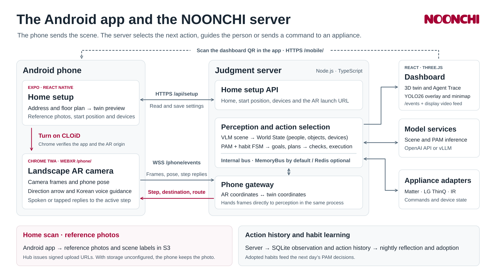

# Android app, WebXR and the NOONCHI server

The dashboard displays a QR for an Android phone to pair with the hub. The native app manages the home and its settings. Turning on CLOiD opens the AR camera in Chrome on the same phone. The server uses the camera observations to choose a step, guide the person holding the phone or control a connected appliance.

| Interaction | What the implementation does |
|---|---|
| Dashboard QR → Android app | The Expo app scans the HTTPS `/mobile/` URL and verifies `GET /api/setup` on the QR’s origin. Its native home screen then reads the hub configuration. The same QR can open the mobile web portal in a browser. [QR pairing](../../apps/android/pairing.ts) · [Native entry](../../apps/android/App.tsx) · [Dashboard QR](../../ui/src/dashboard/PhonePane.tsx) |
| Native app ↔ hub | The user confirms the address and floor plan, previews the prepared twin, and captures or reviews reference views. Native settings cover ThinQ pairing, appliance mode, starting pose, stations and layout save or reset. The hub serves the home and settings APIs. [Home registration](../../apps/android/ConnectedHouse.tsx) · [Settings](../../apps/android/ConnectedSettings.tsx) · [Hub routes](../../src/server/shell.ts) |
| Native app → Chrome WebXR | Tapping **클로이드 켜기** reads the current `android_twa.phone_url` from the hub. Chrome verifies the Android package’s Digital Asset Links relationship with the AR web origin and opens its HTTPS `/phone/` page in a landscape Trusted Web Activity. The AR origin can differ from the QR origin. The page starts an immersive session after the required user gesture and permissions. [Launch](../../apps/android/native-twa.ts) · [Origin checks](../../apps/android/twa.ts) · [Android launch module](../../apps/android/modules/noonchi-twa/android/src/main/java/app/noonchi/twa/NoonchiTwaModule.kt) · [WebXR capture](../../ui/src/phone/core/ar.js) |
| WebXR ↔ phone gateway | The page sends camera frames, pose, projection and step replies over `/phone/events`. The gateway aligns AR and twin coordinates and passes engine images directly to perception in the server process. The return carries the current command and its available guide. The phone draws the direction and speaks the text when requested. A fresh observation or a reply tied to the active step can confirm execution. [Server wiring](../../src/server/home/phone.ts) · [Phone protocol](../../src/contract/phone.ts) · [Phone controller](../../ui/src/phone/controller.ts) · [Speech](../../ui/src/phone/core/talk.js) |
| Perception → judgment → execution | VLM results update World State. PAM uses observations and habit memory to select an action. Goal management, planning and execution checks lead to phone steps or appliance commands. Stages exchange structured messages through MemoryBus by default or RedisBus when `REDIS_URL` is configured. The dashboard receives events over `/events` and uses a separate video feed for the vision minimap and YOLO overlays. [World State](../../src/world/node.ts) · [PAM decision](../../src/brain/decide.ts) · [Execution](../../src/act/robot/steps.ts) · [Bus selection](../../src/bus/open.ts) · [Appliance hubs](../../src/server/home/devices.ts) · [Dashboard](../../ui/src/dashboard/DashboardScreen.tsx) |
| Home reference photos → phone or S3 | For a registered reference scene, the hub can issue signed S3 upload URLs. The Android app uploads the chosen JPEG and its JSON scene label directly and keeps a local copy for review. A 503 response to the signing request selects phone-local storage. Live WebXR judgment frames follow the gateway-to-perception path above. [Reference photo capture and upload](../../apps/android/connected-scan.ts) · [Signing route](../../src/server/routes/home-shots.ts) |
| Structured records → habit memory | SQLite records observations and actions. Nightly reflection reads history, evaluates candidates and stores adopted memory for subsequent decisions. [History database](../../src/record/history.ts) · [Nightly processing](../../src/brain/history/night.ts) · [Adoption test](../../src/brain/pam/adopt.ts) |

See the [Android guide](../../apps/android/README.md) for installation and phone checks and the [WebXR step round trip](webxr-roundtrip.md) for message names, coordinate epochs, and a checked cup-clearing instruction.
