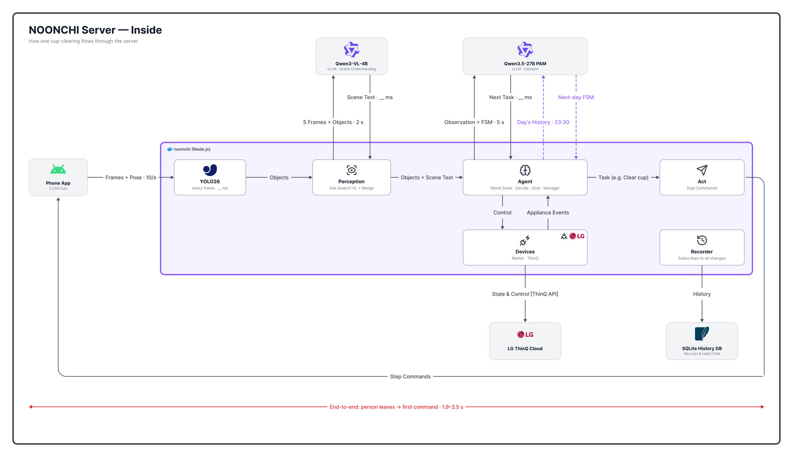

# NOONCHI Architecture Diagram Notes

Author Seokjun Park · 2026-11-21 · Code baseline `noonchi main` at `b07f0c11` (2026-11-20)

The two diagrams follow the C4 model. Each shows a different level of detail.

| Diagram | C4 level | What it shows |
|---|---|---|
| `architecture.svg` | Level 2 (containers) | Where the separately running programs are deployed and how they connect. |
| `noonchi-server-inside.svg` | Level 3 (components) | The order of work inside the noonchi server and the data passed between its components. |

Splitting the diagrams keeps the connections readable. Level 3 expands the noonchi server, which the team built. The two vLLM services and Redis run as third-party services and appear as whole containers.

---

## 1. System Deployment (Level 2)

### What the boundaries show

- **Home** contains the phone app, which serves as CLOiD's eyes, and the household appliances.
- **LG ThinQ Cloud** is an external service operated by LG.
- **AWS Cloud → EC2 (g6e.2xlarge · Ubuntu)** represents one rented server.
- **Docker Compose** runs four containers on that server (`noonchi`, `vllm-vlm`, `vllm-pam`, and `redis`).
- **SQLite History DB** sits outside the Compose boundary because it is a file on the server's EBS volume.
- **Matter and YOLO26** run inside the noonchi container. The arrow between Node.js and YOLO26 represents sending a frame and receiving a list of detected objects.

### How to read the arrows

- Each arrow points from the caller to the receiver. Replies travel back along the same connection.
- Labels follow the short format `Data [Protocol]`.

### Steps ①–④ for clearing a cup

The numbers follow a frame from the phone through to the instructions sent back.

| Step | Connection | What happens when clearing a cup |
|---|---|---|
| ① | Phone App → noonchi · Frames + Pose [WSS] | The phone sends frames and its pose every 0.1 seconds over the private Tailscale network. |
| ② | noonchi → Qwen3-VL-4B · Scene Query [HTTP] | Every 2 seconds, noonchi sends five frames and receives a scene description such as “An empty cup is on the table. The person has left.” |
| ③ | noonchi → Qwen3.5-27B PAM · Decision & Reflection [HTTP] | Every 5 seconds, noonchi sends observation text and the habit rules (an FSM) and receives a task such as “Clear the cup.” The same model handles nightly reflection. |
| ④ | noonchi → Phone App · Step Commands [WSS] | noonchi sends instructions such as “Please go to the table” and “Please pick up the cup” over the same connection as step ①. |

### Unnumbered connections

These connections support ongoing messaging, appliance control, and history storage.

| Connection | What it does |
|---|---|
| noonchi → Redis · Messages [Streams] | Redis Streams carries messages between noonchi nodes throughout the sequence. |
| noonchi → LG ThinQ Cloud · State & Control [ThinQ API] | Reads appliance state, such as an open refrigerator door, and sends commands, such as turning on the air conditioner. |
| LG ThinQ Cloud → Home Appliances · State & Control | LG's service exchanges state and commands with LG appliances in the home. |
| noonchi → Home Appliances · State & Control [matter] | Reads and controls appliances using the Matter standard. At this baseline, the Matter appliances were simulated inside noonchi. Raspberry Pi infrared control of a physical TV was planned. |
| noonchi → SQLite · History [Read/Write] | Writes daily history and versions of the habit rules, then reads them during nightly reflection. |

---

## 2. Inside the noonchi Server (Level 3)

### Cup-clearing flow

1. **YOLO26** finds the positions and shapes of people and objects and estimates human poses in each frame.
2. **Perception** queries Qwen3-VL every 2 seconds with five frames and the YOLO detections. It combines the returned scene description with the detections.
3. **Agent** turns the World State into observation text and queries Qwen3.5 PAM every 5 seconds. PAM returns a task such as “Clear the cup.”
4. **Act** sends the task to the phone as a series of instructions, such as “Please go to the table” and “Please pick up the cup.”
5. **Devices** forwards appliance signals to Agent and sends the appliance commands Agent selects. The Matter link goes to Home Appliances and the ThinQ link goes to LG appliances. The baseline simulates Matter appliances inside noonchi. Physical TV power control was planned.
6. **Recorder** writes changes to SQLite.
7. **Nightly reflection at 23:30 (purple dotted line)** sends the day's history to Qwen3.5 PAM and receives the habit rules for the next day.

The red line at the bottom shows the 1.9–3.5 seconds from the person's departure to the first instruction, measured on three recorded videos. [README results](../../README.md#iv-results)

The `__ ms` fields mark timings that were still unmeasured. The code already measured YOLO latency. The two Qwen services still needed their own measurements.

### Why YOLO26 appears before Perception

- The separate box shows that YOLO runs first on every frame and that its detections accompany the Qwen query.
- Qwen3-VL returns its answer directly to **Perception**. YOLO helps locate objects and estimate shapes and poses. Qwen3-VL determines whether a cup is present, what someone is holding, and what they are doing. [Observation](../../README.md#b-observation-yolo26-and-the-vlm)

---

## 3. What the Diagrams Simplify

- **YOLO26 and Perception** are part of the same `perception` node in `src/observe/`. YOLO runs on a worker thread. The diagram gives it a separate box to make the order clear.
- **Agent** combines the `world`, `brain`, `goal`, and `manager` nodes in one box.
- **Phone input and output** appear as arrows. The code has a separate `phone` node.
- **Redis** carries messages between the noonchi nodes at this baseline. The diagrams omit the internal Redis Streams links to keep the connections readable.
- **Dashboard** is outside the scope of these two diagrams.
- **Local development** can use OpenAI models in place of the Qwen services on a PC without a suitable GPU. The diagrams show the demonstration server.

## 4. Work Planned at This Baseline

- **Reviewing decisions after the fact** was in design. The proposed nightly review would compare the robot's decisions with the user's actions and classify them as correct decisions, missed opportunities to help, or excessive interventions. The results would update the long-term user memory, including daily notes and the user profile.

## Sources for the Figures

| Value | Source |
|---|---|
| A frame every 0.1 seconds | [Observation](../../README.md#b-observation-yolo26-and-the-vlm) |
| Qwen3-VL every 2 seconds with up to five frames | [Observation](../../README.md#b-observation-yolo26-and-the-vlm) |
| PAM every 5 seconds (1 second for nano models) | [Behavior Prediction](../../README.md#d-behavior-prediction-person-state-fsm-and-pam) |
| Nightly reflection at 23:30 | [`REFLECT_AT` default](../reference.md#runtime-settings) |
| 1.9–3.5 seconds to the first instruction | [README video results](../../README.md#iv-results) |
| EC2 g6e.2xlarge | [Deployment guide](../deploy.md) |

## November 24 Guides

The November 24 guides cover QR pairing, native Android home setup, and the Chrome TWA camera. They follow the WebXR socket, the dashboard feed, and the round trip for a checked instruction. The current server uses MemoryBus by default and RedisBus when `REDIS_URL` is set. The phone gateway hands engine images directly to the observation pipeline. [Android app architecture](android-app-system.md) · [WebXR step round trip](webxr-roundtrip.md)
