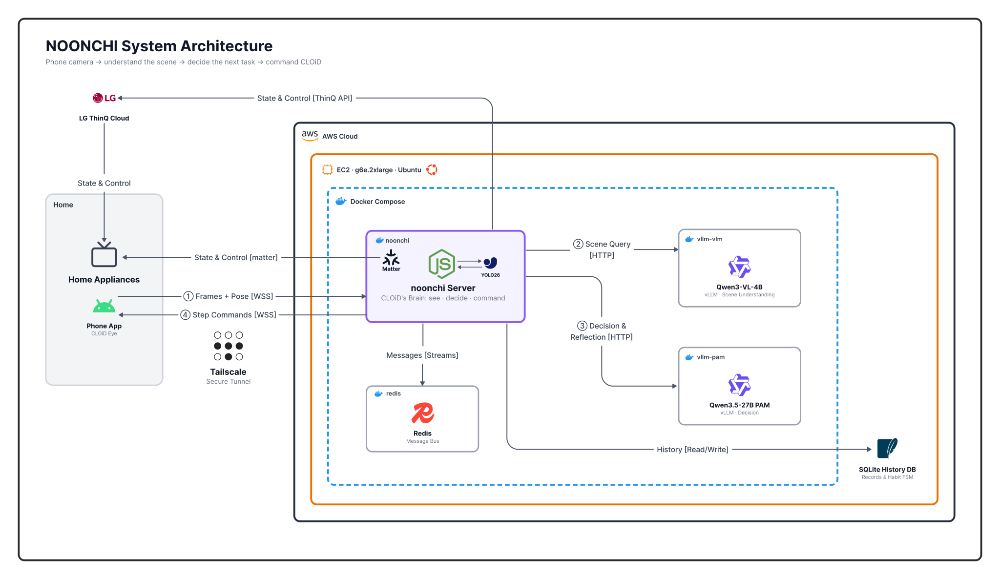

# NOONCHI 구조 그림 설명

작성: 박석준 · 2026-11-21 · 기준 코드: noonchi main `b07f0c11` (2026-11-20)

구조 그림을 두 장으로 나눴다. 회사에서 많이 쓰는 C4 방식을 따랐다.

| 그림 | 단계 | 보여 주는 것 |
|---|---|---|
| `architecture.svg` | 2단계 (전체 배치) | 따로 도는 프로그램들이 어디서 돌고 무엇으로 연결되는지 |
| `noonchi-server-inside.svg` | 3단계 (noonchi 확대) | noonchi 서버 안에서 일이 어떤 순서로, 무엇을 주고받으며 지나가는지 |

한 장에 다 넣으면 선이 엉켜서 둘로 나눴다. 3단계는 우리가 직접 짠 noonchi만 확대했다.
vLLM 두 개와 Redis는 남이 만든 프로그램을 그대로 띄운 것이라 안을 그리지 않았다.

---

## 1. 전체 배치 (2단계)

### 틀의 뜻

- **Home**: 집. 폰 앱(클로이드의 눈)과 LG 가전이 있다.
- **LG ThinQ Cloud**: LG 회사 서버. 우리 서버 밖에 있다.
- **AWS Cloud → EC2 (g6e.2xlarge · Ubuntu)**: 빌린 서버 한 대.
- **Docker Compose**: 그 서버 안의 컨테이너 4개 (`noonchi`, `vllm-vlm`, `vllm-pam`, `redis`).
- **SQLite History DB**: 컨테이너가 아니라 서버 디스크(EBS)에 있는 기록 파일이라 도커 틀 밖에 뒀다.
- noonchi 상자 모서리의 YOLO26·Matter 로고는 noonchi 컨테이너 **안에서** 도는 부품이라는 표시다. 따로 컨테이너가 아니다.

### 화살표 규칙

- **먼저 말을 거는 쪽에서 받는 쪽으로 한 방향**으로 그었다. 답은 같은 선으로 돌아온다고 본다.
- 글자는 `무엇을 [어떤 방식으로]`만 짧게 썼다.

### 번호 ①~⑥: 설명 순서 (시간 순서 아님)

컵 치우기 한 번을 떠올리며 설명하는 순서로 붙였다.

| 번호 | 연결 | 컵 치우기에서 하는 일 |
|---|---|---|
| ① | Phone App → noonchi · Frames & Commands [WSS] | 폰이 사진과 위치를 0.1초마다 보낸다. 명령(「식탁으로 가 주세요」)도 이 선으로 돌아온다. Tailscale 사설망을 지난다 |
| ② | noonchi → Qwen3-VL-4B · Scene Query [HTTP] | 2초마다 사진 5장을 보내 「식탁 위에 빈 컵, 사람 나감」 같은 장면 문장을 받는다 |
| ③ | noonchi → Qwen3.5-27B PAM · Decision & Reflection [HTTP] | 5초마다 관찰 글과 습관 규칙표(FSM)를 보내 「컵 치우기」 같은 할 일을 받는다. 밤 반성도 이 모델이 한다 |
| ④ | noonchi → Redis · Messages [Pub/Sub] | noonchi 안 노드들이 모든 단계에서 메시지를 주고받는 게시판. 특정 순서가 아니라 늘 쓰인다 |
| ⑤ | noonchi → LG ThinQ Cloud · State & Control [ThinQ API] | 냉장고 문 열림 같은 가전 상태를 읽고, 에어컨 켜기 같은 명령을 보낸다 |
| ⑥ | noonchi → SQLite · History [Read/Write] | 하루 기록과 습관 규칙표 판본을 쓰고, 밤 반성 때 읽는다 |

---

## 2. noonchi 서버 안 (3단계)

### 흐름 (컵 치우기)

1. **YOLO26**: 사진마다 사람·물건 위치, 모양, 자세를 찾는다.
2. **Perception**: 욜로 결과와 사진 5장을 들고 2초마다 Qwen3-VL에 묻고, 돌아온 장면 문장과 욜로 결과를 합친다.
3. **Agent**: 집 상태(World State)를 관찰 글로 만들어 5초마다 Qwen3.5 PAM에 묻고, 할 일(예: Clear cup)을 받는다.
4. **Act**: 할 일을 단계 명령으로 폰에 보낸다 (「식탁으로 가 주세요」 → 「컵을 들어 주세요」 → …).
5. **Devices**: 가전 신호를 Agent에 넘기고, Agent가 정한 가전 조작을 Matter 가상 가전·LG ThinQ로 보낸다.
6. **Recorder**: 모든 변화를 SQLite에 적는다.
7. **밤 23:30 (보라 점선)**: 하루 기록을 Qwen3.5 PAM에 보내 반성하고, 다음 날 쓸 습관 규칙표를 받는다.

맨 아래 빨간 줄(사람이 떠난 뒤 첫 명령까지 1.9~3.5초)은 실제 영상 3개로 잰 값이다(noonchi README 결과 표).
`__ ms` 칸은 아직 재지 않은 시간이다. 욜로 시간은 코드가 이미 재고 있고, 큐원 두 개 시간은 따로 재야 한다.

### YOLO26을 Perception 앞으로 뺀 이유

- 사진마다 **욜로가 먼저** 돌고, 그 결과(물건 목록)를 **들고** 큐원에게 묻는 순서를 한눈에 보이려고.
- 큐원-VL의 답은 욜로가 아니라 **Perception으로** 돌아온다. 욜로는 자리·모양·자세를 돕는 보조이고, 컵이 있는지, 손에 뭘 들었는지, 사람이 뭘 하는지는 큐원-VL이 정한다(README "Observation" 절).

---

## 3. 코드와 다르게 줄인 곳

코드와 맞대 볼 때 헷갈리지 않도록 적어 둔다.

- **YOLO26과 Perception**: 코드에서는 한 노드(`perception`, `src/observe/`)다. 욜로는 그 노드의 별도 작업 스레드에서 돈다. 순서를 보이려고 칸을 나눴다.
- **Agent**: 코드의 `world`, `brain`, `goal`, `manager` 노드를 한 칸으로 합쳤다.
- **폰 입출력**: 코드의 `phone` 노드는 따로 그리지 않고 화살표로만 표시했다.
- **Redis**: noonchi 안의 화살표는 실제로 전부 Redis(Pub/Sub)를 거친다. 선이 엉켜서 그림에서는 생략했다.
- **대시보드**: 그림에 넣지 않았다.
- **로컬 개발**: 그림은 서버(시연) 기준이다. 로컬 PC에서 개발할 때는 그래픽카드가 없어 큐원 대신 OpenAI 모델을 임시로 쓴다.

## 4. 앞으로 더할 것

- **사후 판단 (planned)**: 밤에 그날 로봇 판단을 사용자 행동과 맞대서 「맞음 / 놓친 도움 / 지나친 개입」으로 채점하고, 장기 사용자 기억(하루 일기·프로필)을 고친다. 설계 중이며 그림에 아직 없다.

## 숫자 출처

| 값 | 출처 |
|---|---|
| 사진 0.1초마다 | noonchi README "Observation" 절 |
| Qwen3-VL 2초마다 · 최대 5장 | 같은 절 |
| PAM 판단 5초마다 | README "Behavior Prediction" 절 (nano 모델이면 1초) |
| 밤 반성 23:30 | `docs/reference.md` `REFLECT_AT` 기본값 |
| 첫 명령까지 1.9~3.5초 | README "Results" 절 영상 시험 |
| EC2 g6e.2xlarge | `docs/deploy.md` |
