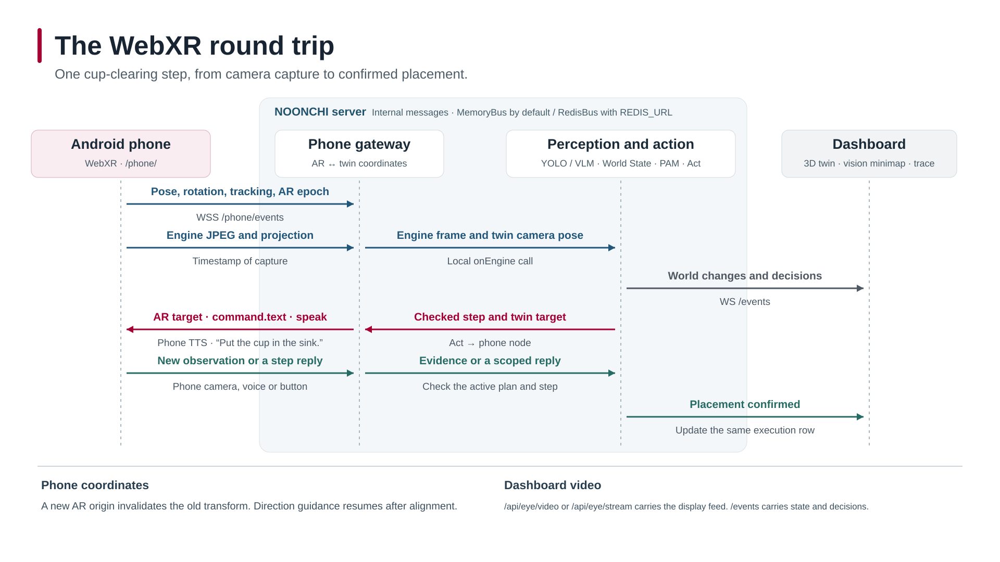

# How the phone and NOONCHI exchange a step

The Android phone sends camera frames and its pose. The server aligns the pose with the home, chooses an action, and sends the current step back. For cup clearing, “싱크대로 가 주세요” asks the person to walk to the sink. Once arrival is confirmed, the server sends “컵을 싱크대에 넣어 주세요.” The phone reads the text aloud. A later observation confirms placement and completes the execution row shown in the diagram.

| Direction | Interface | What crosses it |
|---|---|---|
| Android app → phone page | HTTPS `/phone/` | The app reads the phone origin from the paired hub. A user gesture starts the browser’s immersive AR session. The browser supplies tracking and camera access. |
| Phone → phone gateway | WSS `/phone/events` | The page sends its `hello` protocol version, exchanges clock samples, and sends `pose` messages for valid tracking samples at approximately 100 ms intervals. Engine JPEG packets carry the capture timestamp, AR origin epoch, camera pose and projection matrix. Pose and image sampling have independent schedules. |
| Gateway → perception → World State | `onEngine`, then `/perception/scene` and `/world/state` or `/world/changes` | The gateway looks up the transform for the captured epoch and attaches the twin-space camera view when available. It hands the image to the local observation pipeline. Perception publishes structured results on the internal bus. Detection shapes for the vision overlay travel on `/perception/detections`. |
| Judgment and execution → phone | `/brain/decision` → execution checks → `/act/phone_changes` → WSS `/phone/events` | The execution tracker emits the step. The phone node delivers its changes and uses `/act/phone_command` to restore current state. The gateway transforms the twin destination and available guide points into the current AR frame. The phone projects the direction and reads the command text when `speak` is true. |
| Phone → execution tracker | New engine frame, or a scoped user answer | New visual evidence returns through perception and World State. A spoken or tapped step answer is paired with the step visible at the time and routed through `/phone/progress`. Its result can advance, hold or end the step. Approval prompts have their own pending token. |
| Server → dashboard | WS(S) `/events` plus HTTP(S) display video | Vision uses the display feed at `/api/eye/video`, with `/api/eye/stream` for MJPEG. The twin displays the plan and Action Conditions shows scoped evidence and the next planned step. The Agent Trace groups public observations, calls, actions, and outcomes by activity and expands related tool calls while they are active. |

A phone AR origin epoch identifies one local coordinate system. Starting a new origin invalidates the previous transform. Before alignment or while the direction is unreliable, the gateway can deliver a text instruction without valid direction guidance. A reconnect restores the current instruction silently. Capturing a frame, receiving a model response, speaking a command, and verifying the resulting state are separate events.

The diagram follows the Android app’s `/phone/` page. The hub’s `/mobile/` web portal opens `/mobile/phone-events` on its own origin and hands that socket to the same phone gateway. The dashboard uses `/events`. Inside the Node.js server, `openBus` selects MemoryBus by default and RedisBus when `REDIS_URL` is configured. The gateway’s engine-image handoff is a local call in both configurations.

## Follow the code

| Boundary | Source |
|---|---|
| Session startup, pose and engine encoding | [Phone AR capture](../../ui/src/phone/core/ar.js) · [phone WebSocket and clock](../../ui/src/phone/core/link.js) |
| Image ingress and coordinate transforms | [Phone gateway](../../src/phone/server.ts) · [AR session and epoch](../../src/phone/session.ts) · [server wiring](../../src/server/home/phone.ts) |
| Perception and message transport | [Perception publisher](../../src/observe/node.ts) · [World State input](../../src/world/node.ts) · [topic contracts](../../src/bus/topics.ts) · [bus selection](../../src/bus/open.ts) |
| Decision, checked command and speech | [Decision](../../src/brain/decide.ts) · [step commands](../../src/act/robot/steps.ts) · [phone delivery](../../src/phone/node.ts) · [controller](../../ui/src/phone/controller.ts) · [speech output](../../ui/src/phone/core/talk.js) |
| Dashboard state and video | [Dashboard socket](../../src/server/app.ts) · [display feed](../../ui/src/dashboard/panels/eye-video.ts) · [bento view](../../ui/src/dashboard/DashboardScreen.tsx) |
| Hardware-free checks | [Engine and display packets](../../tests/phone-server.test.ts) · [web portal socket](../../tests/mobile-phone-ws.test.ts) · [phone alignment](../../tests/phone-sync.test.ts) · [cup assistance replay](../../tests/assistance-cup-replay.test.ts) · [speech delivery and silent reconnect](../../tests/phone-speech-wire.test.ts) · [automatic trace](../../ui/tests/dashboard/trace-tree.test.tsx) |
