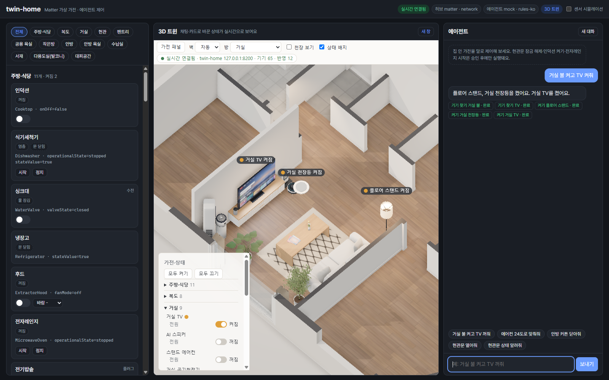
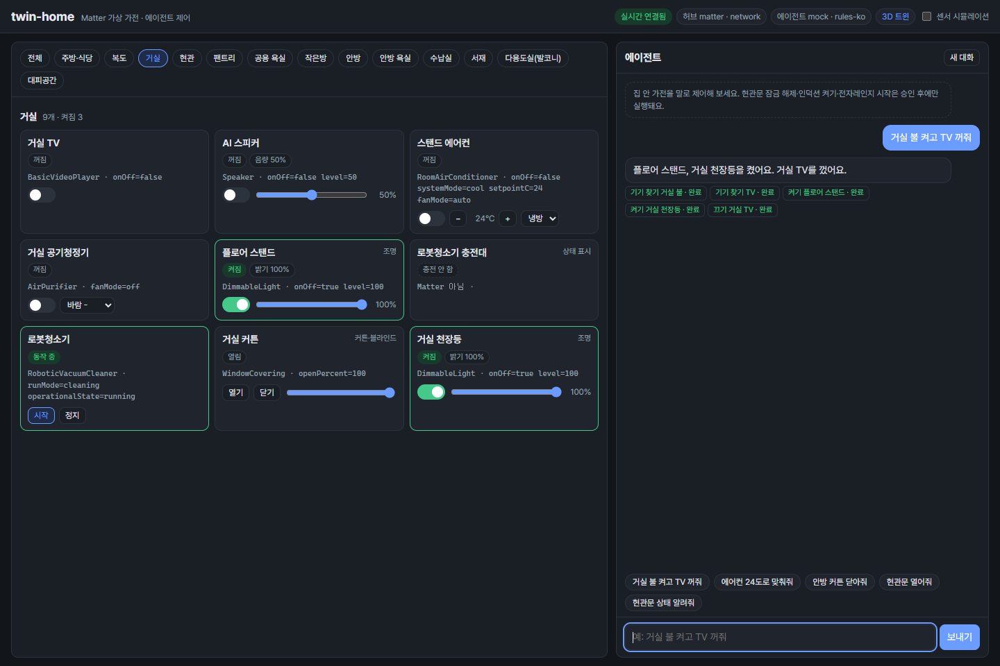

# twin-home 상세 설명

> 2026-10-11 기준 상세 문서다(예전 README). 이후 바뀐 점: 웹 화면의 기기 카드는 기본으로 숨기고 헤더의 "기기 카드" 버튼으로 연다. 조명을 켜고 끌 때 화면이 멈추던 문제는 twin-studio 뷰어가 광원을 미리 만든 풀에서 빌려 쓰도록 바꿔 해결했다([twin-studio apartment/README.md](https://github.com/2026-SWE/twin-studio/blob/main/apartment/README.md)).

twin-studio가 만든 아파트 트윈의 가전 65개를 **가상 Matter 기기**(matter.js 브리지)로 띄우고, 에이전트(LLM)에게 한국어로 요청해 켜고 끈다. 상태의 원천은 Matter 속성이고, 바뀐 상태는 웹 화면(WebSocket)과 **3D 트윈**(twin-studio 뷰어)에 실시간으로 반영된다. 3D 트윈에서 바꾼 상태도 승인 정책을 거쳐 twin-home으로 돌아온다.

계약 문서는 [`docs/plan.md`](plan.md)다. 인터페이스·형식을 바꾸려면 그 문서를 먼저 고친다.



*`npm start`(허브 matter · network, mock 에이전트)로 띄우고 헤드리스 Chrome으로 채팅에 "거실 불 켜고 TV 켜줘"를 입력해 찍었다. 가운데 3D 트윈(`/twin/viewer/?live=auto&embed=1`)에서 거실 TV 화면이 켜지고 "거실 TV 켜짐·거실 천장등 켜짐·플로어 스탠드 켜짐" 배지가 뜬다. 위쪽 칩은 뷰어의 실시간 연결 상태다.*



*`npm start`(허브 matter · network)로 띄운 화면이다. 채팅에 "거실 불 켜고 TV 꺼줘"를 보내면 거실 천장등·플로어 스탠드가 켜지고(`onOff=true`) 거실 TV가 꺼진다(`onOff=false`). 헤드리스 Chrome으로 실제 클릭·입력해 찍었다.*

## 빠른 시작

Node 22 이상. twin-studio 레포가 옆 폴더(`../twin-studio`)에 있어야 한다.

```bash
npm install
cp .env.example .env    # 선택. 키는 .env에만 넣는다(git에 올리지 않음). 키가 없으면 mock 에이전트
npm start               # http://127.0.0.1:8200  (허브 matter, network 전송)
```

브라우저로 <http://127.0.0.1:8200/>을 열고 채팅에 "거실 불 켜고 TV 꺼줘", "에어컨 24도로 맞춰줘", "현관문 열어줘"(승인 후 실행)를 입력한다. 가운데 3D 트윈에 바로 보인다(아래 "3D 트윈 연결").

## 구조

```
src/
  hub/types.ts          DeviceSpec·DeviceState·Command·DeviceHub (공용 계약)
  hub/memory.ts         MemoryHub: Matter 없이 메모리에서 동작하는 DeviceHub (테스트·HUB=memory)
  matter/               MatterHub: matter.js 브리지(가상 가전) + 컨트롤러 (아래 "Matter")
  model/mapping.ts      twin type/attrs ↔ Matter 기기·클러스터 매핑 표와 변환 함수
  model/devices.ts      twin-studio 데이터 → DeviceSpec[] + 초기 상태
  agent/                도구 호출 루프(agent.ts), 도구(tools.ts), 기기 찾기, 승인 정책(policy.ts), 공급자(providers/)
  server/start.ts       시작 순서: twin 데이터 → 허브(대체 경로 포함) → 정책·에이전트 → HTTP/WS
  server/hubFactory.ts  HUB 고르기, startHub(network 실패 → local → memory)
  server/app.ts         REST + WebSocket + 정적 파일
  server/main.ts        npm start 진입점(.env, 출력, 종료 신호)
  mcp/                  MCP stdio 서버(server.ts)와 REST 백엔드(client.ts)
web/                    웹 화면(빌드 없는 ES 모듈)
scripts/demo.ts         npm run demo
scripts/scenarios.ts    데모 시나리오(데모와 e2e 테스트가 함께 씀)
scripts/matter-smoke.ts Matter 연기 시험
tests/                  vitest (helpers/: 작은 집, REST·WS·MCP 도우미)
```

## 명령

| 명령 | 하는 일 |
|---|---|
| `npm start` | 서버 실행(기본 포트 8200, 허브 matter/network). Ctrl+C로 정상 종료 |
| `npm run dev` | 서버 실행 + 파일이 바뀌면 재시작 |
| `npm test` | vitest 전체(단위 + Matter 통합 + e2e, 실제 커미셔닝 포함) |
| `npm run typecheck` | `tsc --noEmit` |
| `npm run demo` | 임의 포트에 서버(matter/local + mock)를 띄워 시나리오 5개(6단계)를 REST·WS로 돌리고 표를 찍는다. 모두 통과면 종료 코드 0 |
| `npm run mcp` | MCP stdio 서버(실행 중인 서버의 REST를 부른다) |
| `npx tsx scripts/matter-smoke.ts` | Matter만: 커미셔닝 → 거실 TV·천장등 토글 → 상태 출력 |

```bash
HUB=memory npm start                     # Matter 없이(빠름)
MATTER_TRANSPORT=local npm start         # Matter 데이터 모델은 쓰되 네트워크 없이
MATTER_TRANSPORT=network npm run demo    # 데모를 실제 커미셔닝으로(임시 저장 폴더·임의 포트)
HUB=memory npm run demo
```

## 환경 변수 (`.env.example`)

| 이름 | 기본값 | 뜻 |
|---|---|---|
| `AGENT_PROVIDER` | (자동) | `openai` / `anthropic` / `mock`. 비우면 `ANTHROPIC_API_KEY` → anthropic, 없고 `OPENAI_API_KEY` → openai, 둘 다 없으면 mock(경고) |
| `OPENAI_API_KEY`, `OPENAI_MODEL`, `OPENAI_BASE_URL` | `gpt-5.5` | OpenAI(Responses API) |
| `ANTHROPIC_API_KEY`, `ANTHROPIC_MODEL` | `claude-opus-5-5` | Anthropic(Messages API) |
| `ANTHROPIC_EFFORT` | `low` | `low`…`max` |
| `ANTHROPIC_FALLBACKS` | (켬) | `off`면 서버 측 거절 대체를 끈다 |
| `TWIN_STUDIO_DIR` | `../twin-studio` | twin-studio 레포(상대 경로는 실행 위치 기준) |
| `HOME_ID` | `homes.json`의 `default` | 불러올 집(twin-studio `homes.json`의 id, 예: `oneroom`) |
| `RUNTIME_DIR` | `runtime` | 실행 중 만든 파일의 바탕 폴더: 배치 수정본 `homes/<id>/edits.json`, 사진 `photos/`(커밋하지 않음) |
| `PHONE_PORT`, `PHONE_HOST` | (끔), `0.0.0.0` | 폰 AR 서버(아래 "폰 AR") |
| `PHONE_MAX_MISMATCH_M`, `PHONE_PHOTO_DIR` | `0.3`, `RUNTIME_DIR/photos` | 기준점 거리 차이 허용값, 사진 폴더 |
| `FOCUS` | (끔) | `1`이면 초점 표시(클로이드가 다룬 물건의 고리·"클로이드 주목")를 대시보드·폰·3D로 보낸다. 기본은 보내지 않는다 |
| `PORT` | `8200` | HTTP 포트(`0`이면 빈 포트) |
| `HOST` | `127.0.0.1` | HTTP 바인드 주소. `0.0.0.0`이면 LAN에서도 열린다(인증 없음) |
| `HUB` | `matter` | `matter` / `memory` |
| `MATTER_TRANSPORT` | `network` | `network`(실제 커미셔닝) / `local`(같은 프로세스 behavior API) |
| `MATTER_COMMISSION_TIMEOUT_MS` | `30000` | network 커미셔닝·연결 단계별 제한 시간. 넘기면 local로 대신 뜬다 |
| `MATTER_STORAGE_DIR` | `.matter` | 브리지·컨트롤러 저장소(커미셔닝 정보) |
| `MATTER_PORT` | `5540` | 브리지 UDP 포트. 컨트롤러는 +1 |
| `MATTER_PASSCODE`, `MATTER_DISCRIMINATOR` | `20261011`, `3011` | 페어링 값. 공개된 개발용 값이니 LAN에 열 때는 바꾼다 |
| `MATTER_DISCOVERY` | `address` | 우리 컨트롤러가 브리지를 찾는 방법: `address`(127.0.0.1:포트) / `mdns` |
| `MATTER_LOG_LEVEL` | `error` | matter.js 로그(`debug`…`fatal`) |
| `MATTER_STORAGE_DRIVER` | `sqlite` | `file`도 된다(matter.js 변수) |
| `MATTER_RUNTIME_SIGNALS` | (끔) | matter.js가 SIGINT를 직접 잡게 하려면 준다(보통 쓰지 않음) |
| `MATTER_MDNS_NETWORKINTERFACE` | | mDNS를 특정 어댑터로 제한(matter.js 변수, 아래 "문제 해결") |
| `TWIN_HOME_URL` | `http://127.0.0.1:8200` | MCP 서버가 부를 twin-home 주소 |

선택 값은 `.env.example`에서 주석으로 두었다. 빈 값(`MATTER_X=`)으로 두면 matter.js가 자기 설정으로 읽을 수 있어서다.

## 서버 (src/server)

### 시작 순서와 대체 경로

`npm start` → `main.ts`(`.env` 읽기) → `startServer()`(`start.ts`):

1. `loadTwin(TWIN_STUDIO_DIR)`: 기기 65개, 방 13개(아래 "기기 목록").
2. `startHub()`(`hubFactory.ts`): 허브를 만들고 시작한다.
   - `HUB`가 없으면 **matter**. `MATTER_TRANSPORT`가 없으면 **network**.
   - network 시작(브리지 UDP, 커미셔닝, 연결, 구독)이 실패하거나 `MATTER_COMMISSION_TIMEOUT_MS` 안에 끝나지 않으면, 그 허브를 정리하고 **local 전송으로 다시 시작**한다. 이때 이렇게 한 줄을 찍는다.
     ```
     [경고] Matter network 전송을 시작하지 못했습니다(브리지 커미셔닝에 실패했습니다: …). local 전송으로 바꿉니다(Matter 데이터 모델은 같고 네트워크·외부 컨트롤러 페어링만 빠짐).
     ```
   - local도 실패하면 경고하고 MemoryHub로 뜬다(서버는 항상 뜬다).
3. `Policy` → 공급자(`createProvider`) → `Agent` → `createApp()` → `listen(PORT, HOST)`.

시작하면 이렇게 출력된다(이 PC, 두 번째 시작부터).

```
twin 데이터: scene (…\twin-studio) · 기기 65개 · 방 13개
[Matter 브리지] UDP 포트 5540, 커미셔닝 됨(패브릭 1개)
  수동 페어링 코드: 25953912363
  QR 페이로드:     MT:Y.K90YDA1327ZK2AG00
  (passcode 20261011, discriminator 3011) 이미 커미셔닝됨: 같은 LAN의 다른 컨트롤러(Home Assistant 등)는 먼저 페어링 창을 연 뒤(POST /api/matter/commissioning-window) 이 코드로 추가한다.
[Matter 컨트롤러] 저장된 커미셔닝을 다시 쓴다(peer1).
twin-home 서버: http://127.0.0.1:8200  (허브 matter/network, 에이전트 mock/rules-ko)
  웹 화면   http://127.0.0.1:8200/
  WS 이벤트 ws://127.0.0.1:8200/events
  3D 트윈   http://127.0.0.1:8200/twin/
  Matter    다른 컨트롤러(Home Assistant 등) 추가: curl -X POST http://127.0.0.1:8200/api/matter/commissioning-window …
```

### REST·WebSocket

| 메서드·경로 | 본문 | 응답 |
|---|---|---|
| `GET /api/health` | | `{ ok, devices, hub, transport, provider, model, twin, eye, home: { id, name } }` |
| `GET /api/homes` | | `{ current, homes: [{ id, name }] }` (twin-studio `homes.json`) |
| `GET /api/layout` | | 배치 보정 상태 `{ ok, home, edits, dirty, savePath, savedAt, items }`. 집 scene.json이 없으면 404 |
| `POST /api/layout/save` | | 수정본을 `RUNTIME_DIR/homes/<id>/edits.json`에 쓴다. `{ ok, path, count, saved_at }` |
| `POST /api/layout/reset` | | 보정을 모두 버린다. 뷰어에 되돌리는 layout 메시지를 보낸다. `{ ok, reverted }` |
| `GET /api/rooms` | | `[{ id, label, deviceCount }]` |
| `GET /api/devices?room=&kind=` | | `[{ ...DeviceSpec, state: DeviceState }]` |
| `GET /api/devices/:id` | | `{ ...DeviceSpec, state }`, 없으면 404 |
| `POST /api/devices/:id/command` | `{ command, confirmToken? }` | 200 `{ ok, state }` / 400 오류 / 404 / **409 `{ needsConfirmation: { token, reason } }`** |
| `POST /api/devices/:id/twin` | `{ attr, value, confirmToken? }` | 3D 트윈에서 바꾼 twin 상태. 200 `{ ok, state, via: "command"\|"sensor", command? }` / 400(없는 attr·값) / 404 / **409 `{ needsConfirmation, command }`** (아래 "3D 트윈 연결") |
| `POST /api/sensors/:id` | `{ attr, value }` | 200 / 400(센서가 아니거나 값이 목록에 없음) |
| `POST /api/agent/chat` | `{ message, sessionId? }` | `{ sessionId, reply, actions, pendingConfirmations, provider }` |
| `POST /api/agent/confirm` | `{ token }` | `{ ok, reply, state, deviceId }`, 토큰이 없거나 만료면 400 |
| `POST /api/agent/cancel` | `{ token }` | `{ ok, reply }` |
| `GET /api/agent/pending?sessionId=` | | 승인 대기 목록 |
| `GET /api/matter` | | `{ ok, transport, commissioning: "none"\|"new"\|"reused", port, controllerPort?, subscribed?, pairing: { manualPairingCode, qrPairingCode, passcode, discriminator, commissioned, fabrics } }`. MemoryHub면 404 |
| `POST /api/matter/commissioning-window` | `{ timeoutSeconds? }`(180~900, 기본 900) | `{ ok, timeoutSeconds, pairing, reply }`. 다른 Matter 컨트롤러용 페어링 창을 연다. local 전송이면 400 |
| `GET /events` (WebSocket) | | 붙으면 `{type:"hello"}`, 모든 기기의 `{type:"state", state}`, 지금 배치 보정의 `{type:"layout"}`들. 이후 바뀔 때마다 `{type:"state"}`, `{type:"agent", event:"action"\|"reply"\|"pending"\|"confirmed"\|"cancelled", ...}`, `{type:"layout"}`, `{type:"focus"}`, `{type:"eye"}`, `{type:"photo"}` (모양은 [plan.md](plan.md)) |

- `command`는 `docs/plan.md`의 `Command` 객체다. 줄임으로 문자열(`"on"`, `"off"`, `"lock"` …)도 받는다.
- 정적 파일: `/`는 `web/`이다. `/twin/`은 고른 집의 twin-studio 산출물 폴더(아파트는 `apartment/`, 원룸 예시는 `homes/oneroom/`), `/twin/viewer/`는 모든 집이 함께 쓰는 뷰어(`homes.json` viewer), `/twin/lib/`은 모든 종류의 GLB(`homes.json` library)다. 경로 탈출(`..`)은 막는다.
- 보안: 기본 바인드는 `127.0.0.1`. 브라우저 출처는 `localhost`·`127.0.0.1`·`[::1]`만 허용한다(CORS, WebSocket). 다른 출처의 POST(페어링 창 열기 포함)는 403이다. 인증은 없다.

### 웹 화면 (web/)

빌드 없이 쓰는 ES 모듈(`index.html`, `app.js`, `style.css`)이다. 밝은 화면과 어두운 화면, 폰 너비(390px)를 지원한다.

- **배치**: 넓은 화면(861px 이상)은 왼쪽 큰 칸이 **3D 트윈**(클로이드가 한 일의 결과), 오른쪽 위가 **클로이드의 눈**(폰 카메라 실시간, 엔진 입력 아님, 폰이 없으면 안내), 오른쪽 아래가 **추론 과정**이다. 860px 이하는 `3D 트윈 / 클로이드의 눈 / 추론 과정` 탭(가로 스크롤 없음).
- **기기 카드**: 결과 전용 화면이라 기본으로 숨긴다. 헤더 **기기 카드**로 왼쪽 서랍을 연다. 밝기·온도·바람 세기·커튼 %, Matter 속성 요약, 센서 시뮬레이션은 여기서만 보고 바꾼다.
- **위 상태줄**: 실시간 연결, `허브 matter · network`(전송 포함), 에이전트 공급자, 고른 집, **배치 보정**(보정 건수·저장 여부, 배치 저장·되돌리기 버튼), **3D 트윈 토글**(숨기면 원래 두 칸, 선택은 브라우저에 기억), 센서 시뮬레이션 스위치. `/twin/`이 없으면 토글 대신 "3D 트윈 없음" 표시가 뜨고 3D 칸은 숨긴다(폰 3D 탭에는 이유를 적는다).
- **기기 패널**: 방 탭, 방별 기기 카드(상태 칩, Matter 요약 `onOff=true level=100` 등, 빠른 제어). 센서는 읽기 전용이고 "센서 시뮬레이션"을 켜면 `/api/sensors`로 문 열림·충전을 바꿀 수 있다.
- **3D 트윈**: twin-studio 뷰어를 iframe(`/twin/viewer/?live=auto&embed=1`)으로 넣는다. "새 창"으로 따로 열 수 있다.
- **추론 과정**: 요청마다 카드 하나. 접으면 요청과 답 한 줄(상태 완료·승인 대기·실패), 펴면 에이전트가 거친 단계(도구 이름을 쉬운 말로, 대상, 결과와 이유), 답, 초점 대상이 순서대로 보인다. 승인·취소 버튼은 그 카드 안에 있고, 어디서 승인하든(폰·"응") 결과가 그 카드에 남는다. 폰 대화(🎙)·사진(📷)·배치 저장·되돌리기도 같은 흐름에 쌓인다. 아래 추천 요청은 고른 집의 기기 이름으로 만든다.
- **클로이드의 눈**: 폰 카메라 실시간 화면. 클로이드가 방금 다룬 물건이 있으면 캡션이 `클로이드 주목 · 냉장고`로 바뀌고, 화면 프레임에도 폰이 그린 고리가 보인다.
- WebSocket `/events`로 실시간 반영하고, 끊기면 다시 연결한다.

## 3D 트윈 연결

twin-studio 아파트 뷰어(`apartment/viewer/`)에 `?live=`를 주면 twin-home `/events`에 붙어 상태를 3D에 반영하고, 뷰어 가전 패널에서 바꾼 상태를 twin-home으로 보낸다. 뷰어 쪽 코드는 twin-studio `apartment/viewer/live.mjs`(+ `main.mjs`의 몇 줄 훅)다.

### 실행

```bash
# 1) twin-home(이 레포). /twin/에 ../twin-studio/apartment/를 붙인다
TWIN_STUDIO_DIR=../twin-studio npm start
#    → http://127.0.0.1:8200/              웹 화면(3D | 대화, "기기 카드"로 카드 칸 추가), 3D 칸은 같은 출처 /twin/viewer/?live=auto&embed=1
#    → http://127.0.0.1:8200/twin/viewer/?live=auto   뷰어만 크게

# 2) (선택) twin-studio 미리보기 서버(:8100)에서 뷰어를 열어 다른 출처로 붙기
#    http://127.0.0.1:8100/apartment/viewer/?live=ws://127.0.0.1:8200/events
```

| `?live=` 값 | 붙는 곳 |
|---|---|
| `auto`(또는 `1`, 빈 값) | 같은 호스트의 `ws(s)://<host>/events`. twin-home이 `/twin/viewer/`로 줄 때 |
| `ws://127.0.0.1:8200/events` | 그 주소. `http://…`를 주면 `ws://…/events`로 바꾼다. REST는 같은 호스트(`http://127.0.0.1:8200`) |
| (`&embed=1`) | iframe용: 오른쪽 검사 패널·도구를 숨기고, 좁으면(640px 미만) 가전 패널을 접는다("가전 패널" 버튼) |

### 무엇이 맞춰지나

- **twin-home → 3D**: 붙으면 `hello` 뒤 기기 65개 스냅숏, 이후 `state` 이벤트마다 `state.twin`의 attr 중 **그 객체가 가진 attr**만 `aptViewer.setState`로 바꾼다. 3D 객체 id = 기기 id(scene.json placement id, 문은 floorplan 문 id). 같은 값은 건너뛴다.
- 모르는 기기·attr·값은 무시하고 센다. 뷰어 위쪽 칩: `실시간 연결됨 · twin-home 127.0.0.1:8200 · 기기 65 · 반영 N · 무시 N`(마우스를 올리면 종류별 개수). 끊기면 `끊김 · N초 뒤 다시`, 1·2·4…15초 간격으로 다시 붙는다.
- **3D → twin-home**: 연결된 동안 뷰어 가전 패널(스위치·목록, 모두 켜기/끄기 포함)에서 바꾼 값은 **로컬에서 바꾸지 않고** `POST /api/devices/:id/twin`으로 보낸다. 돌아오는 `state` 이벤트가 3D를 바꾼다. 원격 상태를 반영하는 동안에는 보내지 않아 되울림이 없다.
- twin-home이 모르는 객체·attr(장식, 월패드 화면 등)와 끊긴 동안의 변경은 뷰어 안에서만 바뀐다(다시 붙으면 스냅숏으로 덮인다).

### `POST /api/devices/:id/twin` 계약

본문 `{ attr, value, confirmToken? }`. 값은 그 기기 `twinAttrs[attr]` 목록에서 고른다(`"true"`도 `true`로 맞춘다).

| attr 종류 | 바뀌는 것 | 예 |
|---|---|---|
| 센서(`door`, `charging`) | `hub.setSensor` (정책 없음) | `door_bed2` `{attr:"door", value:"open"}` → 200 `via:"sensor"` |
| 제어 attr, 도어록 | `lock` / `unlock` | `door_main` `{attr:"lock", value:"unlocked"}` → **409** |
| 제어 attr, 커튼·블라인드 | `covering` 100%(open) / 0%(closed) | `curtain_living` `{attr:"curtain", value:"closed"}` → `openPercent=0` |
| 나머지 제어 attr(`power`, `running`, `heating`, `faucet`, `water`) | `on` / `off` (동작형은 start/stop, 수전은 valve로 정규화) | `washer_1` `{attr:"running", value:false}` → `stop` |

- 명령은 `/command`와 같은 **승인 정책**을 거친다. 현관문 잠금 해제·인덕션 켜기·전자레인지 시작은 409 `{ ok:false, needsConfirmation:{token, reason}, command }`이고 실행하지 않는다. 토큰으로 `POST /api/agent/confirm {token}`(또는 같은 본문에 `confirmToken`)하면 실행한다.
- 400: attr 없음, 값 없음, 목록에 없는 값, 바꿀 수 없는 attr. 404: 없는 기기. CORS·출처 규칙은 다른 API와 같다(`localhost`·`127.0.0.1`·`[::1]` 출처만, 그래서 :8100 뷰어도 된다).

### 승인 동작(뷰어)

뷰어에서 현관문 잠금을 풀면 스위치가 곧바로 원래대로(잠김) 돌아가고, 화면 아래에 "현관문 잠금 해제는 사용자 승인이 필요합니다. [승인] [취소]" 알림이 뜬다. **승인**은 `POST /api/agent/confirm`을 부르고, 실행되면 state 이벤트로 3D·웹 카드가 함께 바뀐다. **취소**는 `/api/agent/cancel`. 토큰은 5분 뒤 만료된다. 실패(400 등)는 빨간 알림으로 8초 보인다.

### 확인한 것(2026-10-11, 이 PC)

헤드리스 Chrome(CDP)으로 `npm start`(matter/network, mock) + `:8100` 미리보기 서버에서 13개 항목을 확인했다: 3D 칸 기본 표시, 스냅숏 반영(기기 65, 무시 0), 채팅 "거실 불 켜고 TV 켜줘" → 3D의 거실 천장등·플로어 스탠드·TV `on`(REST와 같음), 뷰어 패널 스위치 → REST `on`(클릭 → 3D 반영 33~55ms), 뷰어 현관문 잠금 해제 → 승인 알림·잠김 유지 → 승인 → `unlocked`, `:8100` 다른 출처 뷰어의 수신·패널 POST(CORS), 3D 토글, 390px 가로 스크롤 없음·3D 탭.

따로 한 번 더 확인했다(16개 항목).
- **채팅 → 3D·카드:** "안방 불 켜줘"는 안방 조명 3개, 이어서 "에어컨 켜줘"는 `ac_master`를 켰다. 원격 상태를 반영하는 동안 뷰어가 보낸 요청은 0회였다.
- **승인:** 뷰어에서 현관문 잠금을 풀면 승인 알림이 뜬다. 취소하면 잠김이 유지되고 대기가 0개가 된다. 승인하면 `unlocked`가 된다.
- **새로고침:** 3D가 스냅숏으로 현재 상태를 되살렸다(68개 attr 중 불일치 0).
- **서버 재시작:** `끊김 · N초 뒤 다시`(1·2·4·8·15초)를 거쳐 저절로 다시 붙고, 스냅숏을 다시 반영했다(불일치 0).
- **`?live` 없는 뷰어:** 연결하지 않고 그대로 동작한다.
- **출처 검사:** `evil.com`, `localhost.evil.com`, `null` 출처의 POST는 403이고, WS는 401로 거부된다.

## 폰 AR (클로이드의 눈)

폰(안드로이드 크롬)이 WebXR AR로 자기 위치·방향을 재고, 3D 트윈에 '클로이드의 눈' 원뿔로 실시간 표시한다. 계약은 [plan.md](plan.md) "폰 AR 눈", 코드는 `src/phone/`·`web/phone/`, 뷰어 쪽은 twin-studio `apartment/viewer/eye.mjs`다.

1. PC: `PHONE_PORT=8210 npm start` (PowerShell: `$env:PHONE_PORT=8210; npm start`). 시작 로그의 `폰 AR http://<PC IP>:8210/phone/`를 확인한다. Windows 방화벽 창이 뜨면 **개인 네트워크**를 허용한다.
2. 폰(같은 와이파이): 크롬 `chrome://flags`에서 **Insecure origins treated as secure**를 켜고 `http://<PC IP>:8210`을 넣은 뒤 크롬을 다시 시작한다. WebXR은 보안 출처에서만 켜지기 때문이다.
3. 폰에서 `http://<PC IP>:8210/phone/` → AR 시작 → 평면도에 정한 기준점 두 곳(방 모서리, 폰 버튼에 이름이 나온다)의 바닥을 차례로 조준해 기록한다. 거리 차이가 30cm를 넘으면 다시 맞춘다. 기준점은 twin-studio `floorplan.json`의 `ar_anchors`이고, 없는 예전 집은 도크·현관문 문턱이다.
4. PC 브라우저 `http://127.0.0.1:8200/`의 3D에서 눈 마커가 폰을 따라 움직인다. 추적이 약하면 마커가 회색이 된다.
5. 대시보드 오른쪽 위 "클로이드의 눈" 칸에 폰 카메라 실시간 화면(기본 초당 12장, 폰 주소 뒤에 `?fps=20`·`?w=640`처럼 붙여 바꾼다)이 뜬다. 폰의 **사진 찍기**를 누르면 카메라 원본 크기 사진이 찍은 위치·방향과 함께 대화에 남고 `runtime/photos/`에 저장된다.

- 아이폰은 Safari가 WebXR AR을 지원하지 않아 쓸 수 없다.
- 흰 벽·어두운 곳·빠른 움직임에서는 추적이 약해진다. 오래 걸으면 조금씩 밀리므로 기준점에서 다시 맞춘다.
- 트윈과 같은 구조의 집에서만 위치가 맞는다. 기준점 거리 차이가 30cm를 넘으면 맞춤을 받지 않는다. 구조가 다른 집에서 시험만 하려면 `PHONE_MAX_MISMATCH_M=3`처럼 늘린다(위치는 틀린다).
- 크롬이 AR 카메라 접근(`camera-access`)을 주지 않으면 폰에 "카메라 화면을 보낼 수 없어요"가 뜨고 위치만 보낸다.
- 카메라 화면이 위아래가 뒤집혀 보이면 폰 주소에 `?flip=0`을 붙인다(카메라 텍스처 방향은 실제 폰에서만 확인할 수 있다).
- 실시간 화면은 암호화하지 않은 http로 같은 와이파이 안에서만 오간다.

### 벽 두 곳에 폰을 대서 맞추기(벽 대기)

바닥 기준점 대신, 대시보드에서 고른 벽 지점 A·B에 폰을 대서 수평 위치·방향을 맞춘다. 높이는 재지 않고 눈 마커를 그 자리 방 바닥 위 1.5m(`PHONE_EYE_HEIGHT_M`)에 둔다. 계획: [2026-11-04-phone-wall-touch](superpowers/plans/2026-11-04-phone-wall-touch.md).

1. 대시보드 3D 칸 위 **폰 기준점** → A **3D에서 고르기** → 3D 트윈에서 벽을 누른다(가구는 뚫고 벽·문·창을 잡고, 점은 그 벽의 방 쪽 면에 붙는다). B도 같게. 이름을 적고 **저장**. 3D에 A·B 핀이 뜨고 `runtime/homes/<집>/phone-touch.json`에 저장된다. 두 점은 0.5m 이상, 멀수록 방향이 정확하다.
2. 저장하면 실행 중인 폰이 바로 벽 기준점 모드로 바뀐다. 폰에서 AR 시작 → 화면 가운데 조준점을 실제 A 벽 **바로 아래 바닥**(벽과 바닥이 만나는 선)에 맞추고(초록이면 바닥에 닿음) **A … 아래 바닥 조준하고 기록**. B도 같게. 거리 차이가 `PHONE_MAX_MISMATCH_M`(기본 30cm) 안이면 맞춤.
3. **지우기**를 누르면 평면도 바닥 기준점(`ar_anchors`) 방식으로 돌아간다.

- 근사 맞춤이다. 대시보드의 A·B는 벽의 방 쪽 면 위 점이고 폰은 그 아래 바닥을 조준하므로, 조준이 벽선에서 벗어난 만큼(보통 몇 cm) 어긋난다.
- 벽에 폰을 대는 방식은 카메라가 가려져 위치를 자주 잃어서(2026-11-04 실폰 시험) 바닥 조준으로 바꿨다. 조준점이 바닥에 닿지 않으면 기록하지 않는다.
- 기록하는 순간 화면 가운데 조준점이 위를 보는 수평면이고 폰보다 0.9m 이상 아래면 그 높이로 바닥을 잡는다(탁자 윗면은 거른다. 초점 고리·`FOCUS=1`에만 쓰임). 없으면 기록 높이 − 1.5m로 어림한다. 두 경우 모두 그 기준점 방의 바닥 단차(`floor_z`)를 뺀다.
- AR을 새로 시작하거나 추적 원점이 다시 잡히면 맞춤이 지워진다(다시 기록). 폰은 자세·기록·사진마다 그 AR 원점 이름(epoch)을 붙여 보내므로, 그 순간 연결이 끊겨 있었어도 다시 붙으면 서버가 이전 맞춤을 버린다. 버린 원점의 늦은 자세는 무시하고 늦은 기록은 받지 않으며, 다른 원점에서 찍은 사진에는 위치를 붙이지 않는다. 폰 한 대만 쓴다고 본다(여러 폰이 붙으면 맞춤 하나를 같이 쓴다).
- 기록하는 사이 대시보드에서 A·B를 바꾸거나 지우면 그 기록은 버린다(상태의 `revision`). CCTV 보기에서 고르기를 누르면 위에서 보는 화면으로 돌아가 고른다.

### 폰 화면(가로 촬영)과 속도 측정

- 폰은 가로로 든다. 가운데 조준점, 오른쪽 큰 버튼(🎙 말하기·📷 사진·■ 끝내기), 위 상태 줄(맞춤 상태·거리 차이·추적 약함·보내는 fps). 기준점 버튼은 맞추기 전에만 보이고, 글 입력·다시 맞추기·측정 상세는 ⋯ 메뉴에 있다. 답은 위에 5초 보이고 사라진다. 세로로 들면 "가로로 돌려 주세요"가 뜬다. AR 시작 때 전체 화면·가로 고정을 시도하지만 안 되는 폰이 많다(⋯ 메뉴에 결과).
- 화면 프레임: 기본 초당 12장, 가로 촬영 가로 480px·세로 360px, JPEG 품질 0.55(`?fps=`·`?w=`로 바꾼다). 인코딩은 워커 두 개로 두 장까지 겹치고, 순서가 뒤바뀐 오래된 프레임은 버린다.
- 측정: 폰 ⋯ 메뉴에 최근 2초 보낸 fps·장당 KB, readPixels·인코딩 ms, 와이파이 대기(bufferedAmount), 건너뛴 이유별 횟수(인코딩 중·버퍼 가득·순서 뒤바뀜). 서버는 `/api/eye/stats`에 받은 fps·장당 KB를 내고, 대시보드 눈 캡션에 보인다.

### 말하기·'여기'·초점

- 맞추기 전에도 3D 트윈에 눈 원뿔이 보인다: 위치는 가장 넓은 방의 창에서 방 안쪽 0.8m·높이 1.3m에 고정하고, 방향만 폰을 따라간다(AR을 시작할 때 폰이 보던 방향 = 창에서 방 안쪽). 이 추정 눈(`estimated: true`)은 사진의 찍은 위치에는 쓰지 않는다. 기준점 두 곳을 맞추면 실제 위치로 바뀐다.

6. 폰의 **🎙 누르고 말하기**를 누른 채 말하고 손을 뗀다(크롬 내장 음성 인식, 한국어). 받아쓴 문장은 에이전트(세션 `phone`)로 가고, 답은 폰이 읽어 준다. 음성 인식이 없거나 막히면 아래 글 입력으로 보낸다. 승인이 필요하면 폰에 승인·취소 버튼이 뜬다("응"이라고 말해도 된다).
7. 물건 아래 바닥을 조준점으로 가리키고 "냉장고 위치 여기로 맞춰줘"·"냉장고는 여기 있어"·"TV 여기로 옮겨줘"라고 하면 트윈의 그 물건이 조준점 자리로 옮겨진다(바닥 물건은 폰 쪽을 보게, 벽걸이는 가장 가까운 벽에 붙는다). "배치 저장해"면 수정본을 저장한다(아래 "집 고르기와 배치 보정").
8. (`FOCUS=1`일 때만) 에이전트가 다룬 물건(켠 TV, 옮긴 냉장고 등)은 폰 화면에 파란 고리와 `클로이드 주목 · 이름`으로 8초 동안 보인다. 화면 밖이면 가장자리 화살표로 방향을 가리킨다. 3D 트윈에도 같은 고리가 뜬다.

- 폰 화면 고리와 대시보드 프레임 고리는 XR 시점의 투영 행렬로 그린다. 카메라 이미지가 그 투영과 같다고 보고 그리므로 실제 폰에서 어긋나는지 확인이 필요하다.
- AR을 켠 채로 음성 인식이 되는지는 실제 폰에서 아직 확인하지 않았다. 안 되면 글 입력을 쓴다.
- 폰 말에는 인증이 없다(같은 와이파이의 누구나 보낼 수 있다). 내부 테스트용이다.

## 집 고르기와 배치 보정

twin-studio는 평면도마다 집 패키지를 하나씩 둔다(`homes.json`). twin-home은 `HOME_ID`로 하나를 불러온다.

```bash
# 먼저 twin-studio에서 빌드: uv run python -m studio apartment --home oneroom --no-render
HOME_ID=oneroom PHONE_PORT=8210 npm start
```

1. 실제 집에 맞게 트윈을 고친다: 폰 '여기'(위), 또는 대시보드·폰 채팅("냉장고 오른쪽으로 0.5m", "공기청정기 추가해줘", "TV 빼줘"). 3D 트윈이 바로 바뀌고, 상태줄에 `보정 N건 · 저장 안 함`이 뜬다.
2. "배치 저장해" 또는 상태줄 **배치 저장** → `runtime/homes/<id>/edits.json`. 다시 시작해도 저장한 보정은 다시 적용된다. **되돌리기**는 저장하지 않은 것까지 모두 버린다.
3. 확정: twin-studio에서 `uv run python -m studio apply-edits --home <id> <edits.json>`(먼저 `--dry-run`으로 볼 수 있다) → `uv run python -m studio apartment --home <id> --no-render` → twin-home 재시작. 추가한 가전은 이때부터 Matter 기기로 켜고 끌 수 있다.

- 문·창·벽·바닥·천장 고정 설비는 옮기지 않는다. 다른 물건 위에 놓는 종류(TV·전자레인지 등)는 더할 수 없고, 옮기면 받침째 옮긴다.
- 새 종류의 3D 모델은 집 산출물 → twin-studio `library/`(`python -m studio library`) 순서로 찾고, 둘 다 없으면 회색 상자로 보인다.

## 에이전트 (src/agent)

- `new Agent({ hub, policy, provider, rooms?, maxToolRounds = 6, onEvent? })`: `chat(sessionId, message)`, `confirm(token)`, `cancel(token)`, `pending(sessionId?)`, `subscribe(cb)`. 세션별 대화를 기억하고, 같은 세션 요청은 차례로 처리한다.
- **승인**: 도구가 `needsConfirmation`을 돌려주면 에이전트가 토큰을 세션에 보관하고 LLM에게는 이유만 보여 준다. LLM은 스스로 승인할 수 없다. 사용자는 화면의 승인 버튼(`POST /api/agent/confirm`)이나 같은 세션의 "응/네/확인"으로 확정하고, "아니/취소"로 취소한다.
- **도구**(`tools.ts`, 에이전트·MCP 공용, zod 스키마 + 한국어 설명): `list_rooms`, `list_devices{room?,kind?}`, `find_devices{query}`, `get_state{device_id}`, `turn_on`, `turn_off`, `set_level{percent}`, `set_climate{mode?,setpoint_c?,fan?}`, `set_covering{open_percent}`, `lock`, `unlock`, `start`, `stop`, `set_valve{open}`. `confirm_action{token}`은 MCP에만 있다. `device_id`에 정확한 한국어 이름("거실 TV")도 넣을 수 있다.
  - 도구는 `ToolBackend`로 집을 다룬다. 서버 안은 `localBackend(hub, policy, rooms)`, MCP는 `httpBackend(url)`(REST)이다.
- **기기 찾기**(`search.ts`): 방 이름은 긴 것부터(안방 욕실 > 안방), 별칭(화장실 → 공용 욕실, 부엌 → 주방·식당, 베란다 → 다용도실), 종류 동의어(불 → 조명, 티비 → TV), 조사 떼기.
- **시스템 프롬프트**(`prompts.ts`, 한국어): 방·기기 목록, 승인 규칙, 센서 규칙, 방을 말하지 않으면 직전 방 → 거실, "1~2문장으로 짧게 보고". 바뀌는 상태는 넣지 않는다(캐시 유지).
- **공급자**(`providers/`)
  - `anthropic`: Messages API 도구 사용, `ANTHROPIC_MODEL`(기본 `claude-opus-5-5`). 이 모델은 thinking을 끌 수 없어 `thinking`을 보내지 않고 `output_config.effort`(`ANTHROPIC_EFFORT`, 기본 `low`)로 깊이를 정한다. 거절 대체 `fallbacks: "default"`(beta `server-side-fallback-2026-07-01`)를 기본으로 켠다.
  - `openai`: Responses API 함수 호출, `OPENAI_MODEL`(기본 `gpt-5.5`).
  - `mock`: 규칙 기반 한국어 해석기. LLM처럼 `find_devices` → 제어 도구 순서로 부른다. 켜/꺼/열어/닫아/잠가/잠금 해제/시작/멈춰/상태, `N도`, `밝기·음량 N%`, 냉방·난방·제습·송풍, 바람 세기를 알아듣고, "~고/그리고/,/~랑"으로 여러 요청을 한 번에 받는다.
  - 키는 로그·응답에 넣지 않는다.

## MCP (src/mcp/server.ts)

stdio MCP 서버다. 에이전트 도구를 그대로 노출하고, **실행 중인 twin-home 서버**의 REST(`TWIN_HOME_URL`)를 부른다. 그래서 Claude Code나 Claude Desktop이 그대로 이 집의 에이전트가 된다. 허브가 matter면 MCP 명령도 Matter 속성을 바꾼다(e2e 테스트로 확인).

```bash
npm start                                                       # 먼저 서버를 띄운다(다른 터미널)
claude mcp add twin-home -- npx tsx src/mcp/server.ts           # 이 레포 폴더에서
claude mcp add twin-home -e TWIN_HOME_URL=http://127.0.0.1:8200 -- npx tsx C:/Users/ABC/Desktop/소웨공/twin-home/src/mcp/server.ts   # 다른 폴더에서
```

Claude Desktop(`claude_desktop_config.json`)은 같은 명령을 이렇게 적는다(이 형식은 여기서 실행해 보지 않았다).

```json
{
  "mcpServers": {
    "twin-home": {
      "command": "npx",
      "args": ["-y", "tsx", "C:/Users/ABC/Desktop/소웨공/twin-home/src/mcp/server.ts"],
      "env": { "TWIN_HOME_URL": "http://127.0.0.1:8200" }
    }
  }
}
```

- 사용 예: Claude Code에서 "거실 불 켜고 TV 꺼줘" → `find_devices` → `turn_on`/`turn_off`.
- 승인이 필요한 명령(현관문 잠금 해제, 인덕션 켜기, 전자레인지 시작)은 `needsConfirmation.token`을 돌려준다. 사용자가 승인하면 `confirm_action{token}`으로 실행한다. 웹 화면의 승인 버튼으로 확정해도 된다.
- 실패는 `isError: true`와 한국어 `error`로 돌려준다. 서버가 꺼져 있으면 "twin-home 서버에 연결하지 못했습니다…"라고 알린다.
- stdout은 MCP 전용이고 로그는 stderr로 쓴다.
- 테스트(`tests/mcp.test.ts`, `tests/e2e.test.ts`)는 `node --import tsx src/mcp/server.ts`를 레포 폴더에서 실제로 띄워 SDK 클라이언트로 부른다.

## Matter (src/matter)

`MatterHub`가 `DeviceHub`를 matter.js 0.17.9로 구현한다. 상태의 원천은 브리지의 Matter 속성이고, twin 상태는 `model/mapping.ts`로 계산한다.

| 파일 | 하는 일 |
|---|---|
| `matterHub.ts` | `MatterHub`(DeviceHub), `createMatterHub(twin, opts)`, `matterHubOptionsFromEnv()`, `isNetworkUnavailable(e)`, `info`, `openCommissioningWindow()` |
| `bridge.ts` | `createBridge(devices, opts)`: ServerNode + Aggregator + 가전마다 Bridged 엔드포인트, `formatPairingInfo()` |
| `controller.ts` | 컨트롤러 노드, 커미셔닝(`commissionBridge`), 재연결 주소, 구독 대기 |
| `deviceTypes.ts` | matter.js 기기 종류 → 엔드포인트 타입·고정 설정, `SUBSTITUTIONS`, `DEVICE_TYPE_INFO` |
| `behaviors.ts` | 기본 서버가 명령을 구현하지 않는 클러스터의 최소 behavior |
| `ops.ts` | 매핑의 `MatterOp`를 엔드포인트에 실행, 상태 읽기, 변화 구독 |
| `environment.ts` | 노드별 저장 폴더, 로그 수준, 저장소 드라이버, 신호 처리 |

### 전송

- **network**(기본)
  - 브리지(ServerNode, 기기 65개 중 Matter 기기 62개)를 UDP 5540에 올리고 mDNS로 광고한다. 듣는 주소를 정하지 않아 matter.js 기본값(모든 어댑터)으로 듣는다(`HOST`는 HTTP에만 적용).
  - 같은 프로세스의 matter.js 컨트롤러(UDP 5541)가 페어링 코드로 브리지를 커미셔닝한다(기본 `127.0.0.1:5540`으로 바로, `MATTER_DISCOVERY=mdns`면 검색). 그 뒤로는 Matter Invoke/Write/Read/Subscribe만 쓴다.
  - 커미셔닝 정보는 `.matter/`에 남아 다시 시작하면 재사용한다(`commissioning: "reused"`). 강제 종료(`taskkill /F`) 뒤에도 재사용되는 것을 확인했다.
- **local**: 브리지를 네트워크에 올리지 않고 같은 프로세스의 브리지 엔드포인트를 behavior API로 다룬다. Matter 데이터 모델(클러스터·속성·명령)은 같다. 외부 컨트롤러는 붙일 수 없다.
- **센서**(문 열림): 두 전송 모두 브리지 쪽 `BooleanState.stateValue`에 직접 쓴다. 충전 상태(로봇·무선청소기 충전대 3개)는 Matter 기기가 아니라 twin에만 있다.
- **구독**: 명령 결과와 브리지 쪽 변화(다른 컨트롤러가 바꾼 것 포함)가 모두 허브 → WS로 온다. network의 `start()`는 컨트롤러 구독이 선 뒤에 끝난다.

### Matter 페어링: Home Assistant·SmartThings 등 같은 LAN 컨트롤러에 브리지 추가

브리지는 이미 우리 컨트롤러가 커미셔닝했으므로, 다른 컨트롤러는 **페어링 창을 연 뒤** 같은 코드로 추가한다(multi-admin, 우리 컨트롤러와 함께 쓴다). 아래 순서 중 컨트롤러 앱 쪽 단계는 이 PC에서 실제 앱으로 해 보지 않았다.

1. 서버를 network 전송으로 띄운다(`npm start`). 시작 로그가 `허브 matter/network`인지 확인한다(local로 대신 떴으면 외부 페어링 불가).
2. Windows 방화벽: 처음 실행할 때 node.exe의 네트워크 허용 창이 뜨면 **개인 네트워크**를 허용한다. 직접 열려면 UDP 5540(브리지)과 5353(mDNS) 인바운드를 연다.
3. 페어링 창을 연다(기본 15분, 180~900초).
   ```bash
   curl -X POST http://127.0.0.1:8200/api/matter/commissioning-window -H "content-type: application/json" -d "{}"
   # → {"ok":true,"timeoutSeconds":900,"pairing":{"manualPairingCode":"25953912363","qrPairingCode":"MT:Y.K90YDA1327ZK2AG00",...}}
   ```
   코드는 `GET /api/matter`나 시작 로그로도 볼 수 있다. QR이 필요하면 `qrPairingCode`(MT:…) 문자열을 아무 QR 생성기로 그림으로 바꾸면 된다.
4. 컨트롤러 앱에서 추가한다. 컨트롤러는 이 PC와 같은 LAN(같은 서브넷, IPv6 링크 로컬·mDNS가 통하는 곳)에 있어야 한다.
   - **Home Assistant**: Matter 통합(Matter Server)이 필요하다. 컴패니언 앱에서 설정 → 기기 및 서비스 → 기기 추가 → Matter 기기 추가 → "이미 다른 곳에서 쓰는 기기"를 고르고 11자리 수동 페어링 코드를 넣는다. 브리지 아래에 한국어 이름(`nodeLabel`)으로 기기 62개가 생긴다.
   - **SmartThings**: 앱의 + → 기기 추가 → Matter → QR 스캔 또는 코드 입력.
   - **Apple 홈**: 액세서리 추가 → 코드 입력. "인증되지 않은 액세서리" 경고가 나오면 그대로 추가를 고른다.
   - **Google Home**: 테스트 vendor(0xFFF1/0x8000) 기기는 Google Home Developer Console에 같은 VID/PID로 통합을 만들어 두어야 추가된다.
5. 추가한 뒤 그 앱에서 끄고 켜면 브리지의 Matter 속성이 바뀌고, 구독을 통해 twin-home 웹 화면에도 바로 반영된다. 반대로 에이전트가 바꾼 상태도 그 앱에 보인다.

주의:

- vendor id가 CSA 테스트용 0xFFF1이고 인증받지 않은 기기다. 상용 앱은 경고를 띄우거나 거부할 수 있다(SmartThings는 개발자 모드·Developer Workspace 등록이 필요할 수 있다).
- passcode가 고정값(기본 20261011)이다. 창이 열린 동안 같은 LAN의 누구나 이 코드로 붙일 수 있으니, LAN에 열 때는 `MATTER_PASSCODE`를 바꾼다.
- 처음부터 다시 하려면 서버를 끄고 `.matter/`를 지운다. 컨트롤러 폴더만 지우면 브리지 창을 다시 열어 새로 커미셔닝하고(옛 패브릭은 남음), 브리지 폴더만 지우면 컨트롤러의 옛 기록을 지우고 새로 커미셔닝한다.

### 기기 종류와 대체 (deviceTypes.ts)

matter.js 0.17.9에 매핑 표의 기기 종류 21개가 모두 있어 **대체한 기기 종류는 없다**(`SUBSTITUTIONS = {}`, plan.md의 "Basic Video Player(없으면 On/Off Plug-in Unit)"도 Basic Video Player 그대로). 대신 기기 종류 정의만으로는 부족한 부분을 아래처럼 채우거나 구조를 바꿨다. 모든 엔드포인트에 `BridgedDeviceBasicInformation`(nodeLabel = 한국어 이름, uniqueId = 기기 id, reachable = true)이 붙는다.

| 기기 종류 | 채우거나 바꾼 것 |
|---|---|
| 문 센서가 있는 식기세척기·세탁기·냉장고·현관 도어록 | **구조 변경**: Contact Sensor 자식 엔드포인트 대신 같은 엔드포인트에 BooleanState를 붙였다 |
| Cooktop / Refrigerator | Cook Surface·냉장실 자식 엔드포인트, RefrigeratorAlarm은 생략 |
| Thermostat(보일러) | 매핑의 `auto`(systemMode Auto)를 받으려면 AutoMode가 필요하고 AutoMode에는 Cooling이 따라온다. Heating·Cooling·AutoMode를 켜고 `controlSequenceOfOperation = HeatingOnly`로 냉방을 막았다(deadband 0) |
| RoomAirConditioner | Thermostat(Cooling·Heating·AutoMode), FanControl(Auto) |
| AirPurifier / Fan / ExtractorHood | FanControl(Auto), fanModeSequence = Off·Low·Med·High·Auto |
| BasicVideoPlayer(TV) | 필수 MediaPlayback·KeypadInput 최소 구현 |
| MicrowaveOven | OperationalState(시작·정지·일시정지·재개), MicrowaveOvenMode, MicrowaveOvenControl(PowerAsNumber) |
| Dishwasher / LaundryWasher / LaundryDryer | OperationalState 명령 구현 |
| RoboticVacuumCleaner | RvcRunMode(0 = 대기, 1 = 청소), RvcOperationalState(Pause·Resume·GoHome → Docked) |
| WindowCovering | Lift·PositionAwareLift(goToLiftPercentage). 커튼은 Drapery, 블라인드는 Rollershade. lift 0 = 열림, 10000 = 닫힘 |
| DoorLock | PIN 기능을 켜지 않아 원격 잠금·해제에 PIN이 필요 없다. 패브릭 없이(local) 부르면 상태만 바꾼다 |
| WaterValve | ValveConfigurationAndControl Open·Close 구현 |
| 충전 상태(dock 등 3개) | Matter 기기가 아니다(`matterDeviceType: "none"`), twin 전용 |

### 저장 폴더 `.matter/` (gitignore)

- `twin-home-bridge/`와 `twin-home-controller/`가 생긴다. 기본 드라이버는 sqlite(폴더마다 파일 하나)다. Node 22의 `node:sqlite`는 실험 기능이라 실행마다 `ExperimentalWarning` 한 줄이 나온다.
- file 드라이버는 속성 하나가 파일 하나라 65개 기기면 컨트롤러 폴더만 파일 3,211개, Windows 종료에 11초쯤 걸린다(sqlite는 0.6초). 기존 file 저장소는 자동으로 옮겨진다.
- 다시 시작하면 기본으로 twin 초기 상태로 되돌린다(`keepState: true`면 마지막 Matter 상태를 이어받는다).

## 기기 목록 (src/model/devices.ts)

- 고른 집(`HOME_ID`)의 1순위 `<out>/scene.json` objects 중 `attrs`가 있는 것. 없거나 깨져 있으면 그 집 `<data>`의 `placement.json` + `floorplan.json`의 문 + 카탈로그(`<data>/catalog` → `data/catalog` → 옛 `data/apartment/catalog`)로 만든다(`loadTwin(dir, { source: "auto" | "scene" | "catalog", home })`).
- 초기 twin 상태: scene/placement `state` > 카탈로그 `states.<attr>.default` > attr 기본값(꺼짐·멈춤·닫힘·잠김, 커튼은 열림).
- 문: 방은 twin-studio `layout.py`와 같은 규칙. 이름은 `현관문`, 나머지는 `<들어가는 방> 문`(예: `작은방 문`).
- 월패드(`wall_pad`)·CLOiD 로봇(`robot`)은 twin 전용이라 목록에서 뺀다(`TwinData.skipped`).
- 현재 데이터(2026-10-11, scene.json): 기기 65개(조명 22, 문 센서 9, 수전 4, 에어컨 4, 플러그 3, 충전 상태 3, 커튼·블라인드 3, 팬 3, 공기청정기 2, 나머지 1개씩), 방 13개.

## 기기 매핑 (src/model/mapping.ts)

`TYPE_RULES`(twin type → 종류)와 `KIND_PROFILES`(종류 → matter.js 기기·능력·제어 attr)가 표다.

| 종류 | matter.js 기기 | 능력 | twin attr |
|---|---|---|---|
| light | `DimmableLightDevice` (다운라이트는 `OnOffLightDevice`) | onoff, level | power |
| plug | `OnOffPlugInUnitDevice` | onoff | power |
| tv | `BasicVideoPlayerDevice` | onoff | power |
| speaker | `SpeakerDevice` | onoff, level(음량) | power |
| aircon | `RoomAirConditionerDevice` | onoff, climate, fan | power |
| purifier / fan / hood | `AirPurifierDevice` / `FanDevice` / `ExtractorHoodDevice` | onoff, fan | power (on ↔ fanMode ≠ off) |
| cooktop | `CooktopDevice` | onoff | power |
| microwave | `MicrowaveOvenDevice` | operation | power (on ↔ running) |
| dishwasher / washer / dryer | `DishwasherDevice` / `LaundryWasherDevice` / `LaundryDryerDevice` | operation | running, door(센서) |
| fridge | `RefrigeratorDevice` | — | door(센서) |
| vacuum | `RoboticVacuumCleanerDevice` | operation | running |
| covering | `WindowCoveringDevice` | covering | curtain / blind |
| lock | `DoorLockDevice` | lock | lock, door(센서) |
| contact | `ContactSensorDevice` | — | door(센서) |
| valve | `WaterValveDevice` | valve | faucet / water |
| thermostat | `ThermostatDevice` | onoff, climate | heating |
| status | (Matter 기기 아님) | — | charging(센서) |

- 별칭: onoff가 없는 동작형 기기는 `on/off` → `start/stop`, 밸브는 `on/off` → `valve{open}`. 정책도 바뀐 명령으로 판단한다.
- 안전: 문이 열린 식기세척기·세탁기는 시작하지 않는다. 동작 중이 아니면 일시정지하지 않는다.
- 에어컨·보일러에 `climate` 명령을 주면 켠다. 조명 `level > 0`은 켜고 `0`은 끈다.
- Matter 요약 키(`DeviceState.matter`): `onOff`, `level`(%), `systemMode`, `setpointC`(°C), `fanMode`, `operationalState`, `runMode`, `openPercent`(100 = 열림), `lockState`, `valveState`, `stateValue`(문 센서, true = 닫힘).

## 승인 정책 (src/agent/policy.ts)

- 현관문 잠금 해제, 인덕션 켜기, 전자레인지 시작(`on` 포함)은 승인 토큰이 있어야 실행한다(`CONFIRM_RULES`).
- `policy.guard(hub, id, cmd, confirmToken?)`: 실행할 수 없는 명령은 바로 오류. 승인이 필요하면 `{ ok: false, needsConfirmation: { token, reason } }`(서버는 409). 토큰은 한 번만 쓰고 5분 뒤 만료된다.
- `policy.confirm(hub, token)`: 토큰만으로 대기 중인 명령을 실행한다(화면 승인 버튼).

## 테스트

`npm test`는 11개 파일을 돌린다(이 PC에서 약 1분 반, 실제 UDP 커미셔닝 포함). 이 중 `tests/devices.test.ts`의 catalog 전용 초기값 검사 1개는 scene 데이터일 때 건너뛴다.

| 파일 | 다루는 것 |
|---|---|
| `mapping`, `devices`, `memory`, `policy` | 매핑 표, twin 데이터 읽기(실제 twin-studio 데이터 포함), MemoryHub, 승인 토큰 |
| `agent` | 도구, 기기 찾기, mock 시나리오, 공급자 배선(가짜 API로 요청 모양 확인) |
| `server` | REST·WS(임의 포트), CORS, Matter 정보·페어링 API |
| `twin-sync` | 3D 트윈 → `POST /api/devices/:id/twin`: `twinChange` 매핑(명령·센서·오류), 정책 409 + `/api/agent/confirm`, `confirmToken`, 없는 attr·값 400, 뷰어 출처 CORS |
| `mcp` | MCP stdio 서버를 실제로 띄워 SDK 클라이언트로 호출 |
| `start` | HUB 기본값 matter, network → local → memory 대체 경로 |
| `matter` | 모든 기기 종류의 엔드포인트·명령(local), 실제 커미셔닝·구독·재사용·multi-admin 창(network) |
| `homes`, `layout-editor`, `layout-agent`, `layout-server` | homes.json 읽기·카탈로그 순서, 배치 편집기(옮기기·받침·벽 붙이기·더하기·빼기·되돌리기·수정본·재적용), 배치 도구·mock 의도, REST·WS |
| `phone-session`, `phone-server`, `phone-project`, `focus` | 폰 '여기'·트윈→AR, 말·승인·초점 전달, 초점 투영, `HOME_ID` 통합(폰 "냉장고 위치 여기로 맞춰줘" → layout·focus·저장) |
| `react` | 추론 과정: 서버 안 에이전트 도구의 필수 reason(MCP에는 없음), 실행 전 떼기, 관찰 문장, mock reason |
| `e2e` | `startServer()`(npm start 경로)로 실제 기기 65개 MatterHub를 띄우고: 데모 시나리오를 REST 에이전트로 돌려 **브리지의 Matter 속성**(`onOff`, `occupiedCoolingSetpoint`, `currentPositionLiftPercent100ths`, `lockState`)과 WS 이벤트를 확인, MCP 클라이언트로 `turn_on`·`unlock`→`confirm_action`, network 전송으로 같은 흐름 + 기기 쪽 변경이 구독으로 WS까지 오는지 + 페어링 창, 커미셔닝 제한 시간 초과 → local 대체 |

## 제한 사항

- **외부 Matter 컨트롤러로는 아직 해 보지 않았다.** 페어링 창이 열리는 것(`windowStatus ≠ 0`)까지는 테스트하지만, Home Assistant·SmartThings 앱으로 실제 추가한 적은 없다. 인증받지 않은 테스트 vendor(0xFFF1)다.
- **실제 LLM 호출을 해 보지 않았다.** 키가 없어 anthropic·openai 공급자는 가짜 HTTP API로 요청·도구 루프 모양만 확인했다. 키가 없으면 mock 에이전트로 뜬다.
- `DeviceState.online`은 항상 true다(브리지 연결 상태를 따르지 않는다).
- local로 대신 뜨면 외부 컨트롤러를 붙일 수 없다(시작 로그의 `[경고]`와 `/api/health`의 `transport`로 알 수 있다).
- 시작 시간: 기기 65개 network는 보통 7~10초. 이 PC에 무거운 작업(Blender 빌드 등)이 돌 때는 local도 30초, network 재시작이 2분 가까이 걸린 적이 있다. 커미셔닝 단계별 제한 시간(`MATTER_COMMISSION_TIMEOUT_MS`)은 한 단계에 적용되므로 전체 시작은 그보다 길 수 있다.
- HTTP API에 인증이 없다. 기본 `HOST=127.0.0.1`로만 연다.
- twin-studio `apartment/scene.json`의 초기 `state`를 그대로 쓴다. 지금 scene.json(카탈로그 수정 전 빌드)은 식기세척기·세탁기·건조기·로봇청소기가 `running: true`로 들어 있어 처음 띄우면 넷이 "동작 중"이다. twin-studio가 scene.json을 다시 빌드하면 바뀐다(카탈로그는 이미 `[false, true]`).
- 종료: Ctrl+C(SIGINT)는 서버의 종료 처리(HTTP → 브리지 → 컨트롤러 순)를 탄다. 작업 관리자·`taskkill /F`로 죽이면 정리 없이 끝나지만, 저장소는 다음 시작에 그대로 쓰였다(이 PC에서 확인).
- 웹 화면의 바람 세기 목록으로는 끌 수 없다(전원 스위치를 쓴다).
- 3D 트윈은 twin attr(켜짐·열림·잠김 등 두세 값)만 맞춘다. 밝기·설정 온도·바람 세기·커튼 열림 %는 3D에 없다. 3D에서 커튼을 "열림"으로 바꾸면 100%, "닫힘"은 0%다.
- 뷰어 승인 알림은 뷰어 안에만 뜬다(웹 화면 대화의 승인 카드와 따로). 웹 대화에서 나온 승인 대기는 뷰어에 뜨지 않는다.
- **조명이 켜지고 꺼질 때 화면이 멈춘다.** 뷰어는 조명을 켤 때 three.js 광원을 장면에 더하고 끌 때 뺀다(twin-studio `states.mjs`의 `refreshLight`). 광원 수·종류 조합이 처음 나올 때마다 three.js가 셰이더를 다시 만든다(한 번에 프로그램 약 17개 추가). 그동안 뷰어의 메인 스레드가 막히고, 같은 출처 iframe이라 twin-home 웹 화면(대화·카드)도 함께 멈춘다. 이 PC의 GPU(AMD Radeon, ANGLE D3D11)에서 잰 값:
  - 셰이더 캐시가 비어 있을 때: 프레임 사이 최대 10~15초.
  - Chrome GPU 디스크 캐시가 찬 뒤: 최대 약 0.7초, 3D에 보이기까지 3.5~5초.
  - 이미 나온 조합: 약 0.1초.
  - 헤드리스 SwiftShader: 9~18초.

  조명과 상관없는 변경(클릭·채팅 → 3D)은 33~220ms, 에이전트 응답을 기다리는 경우 약 1.3초였다. 고치려면 뷰어에서 광원 수를 고정해야 한다(불러올 때 광원을 미리 만들고, 끌 때는 빼지 말고 intensity만 0으로). twin-studio 뷰어 쪽 일이다.

### 문제 해결

- `EADDRINUSE`(UDP 5540): 다른 twin-home이 떠 있다. 끄거나 `MATTER_PORT`를 바꾼다. 그대로 두면 local로 대신 뜬다.
- 로그에 `getaddrinfo ENOTFOUND fe80::…%`: Tailscale 같은 가상 어댑터의 영역 없는 IPv6 주소를 mDNS가 광고해서 생기는 경고다. 동작에는 지장이 없다(다음 주소까지 기다림을 1초로 줄였다). 거슬리면 `MATTER_MDNS_NETWORKINTERFACE`로 실제 LAN 어댑터만 쓰게 한다.
- `listen EFAULT: bad address in system call argument 127.0.0.1` / `connect EFAULT`: 이 PC에서 **IPv4** bind·connect가 가끔 이 Winsock 오류로 실패한다. 순수 Node 스크립트로 재 보면 `127.0.0.1` listen(0)이 300번에 5~44번(HTTP+fetch를 섞으면 2000번에 909번) 실패했고, `::1`·`localhost`는 0번이었다. 원인은 확인하지 못했다(Winsock을 가로채는 보안 프로그램을 의심). 그래서 `src/server/net.ts`의 `listenRetry`(서버 listen, 최대 6번)와 `fetchRetry`(연결 단계 EFAULT만, 최대 4번, MCP REST 클라이언트·테스트가 씀)가 EFAULT일 때만 다시 시도한다. 포트가 쓰이고 있으면(`EADDRINUSE`) 다시 시도하지 않고 바로 실패를 알린다.
- `Channel is closed`: 한 피어에 동시 교환이 많을 때 matter.js가 오래된 것부터 닫는다. 시작 때 읽기를 3개씩만 보내도록 해 두었다.

## 개발 규칙

- TypeScript strict, ESM, `tsx`로 실행, `vitest`로 테스트(TDD). import 경로는 `.js` 확장자로 쓴다.
- 사용자에게 보이는 문자열(에이전트 답, 화면, 오류)은 한국어.
- API 키는 출력·커밋하지 않는다(`.env`는 gitignore).
